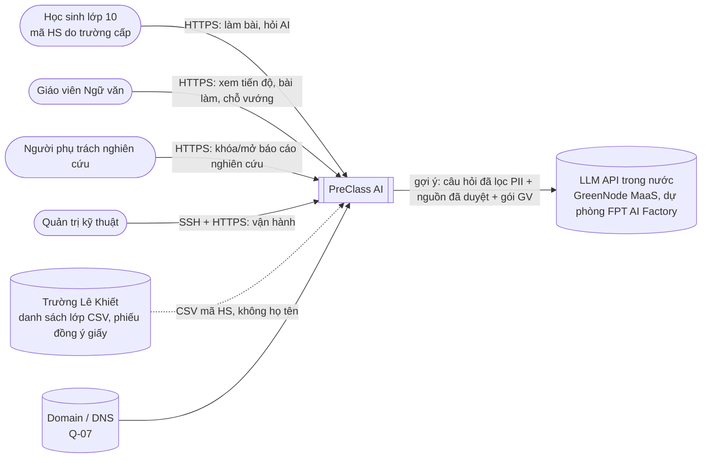
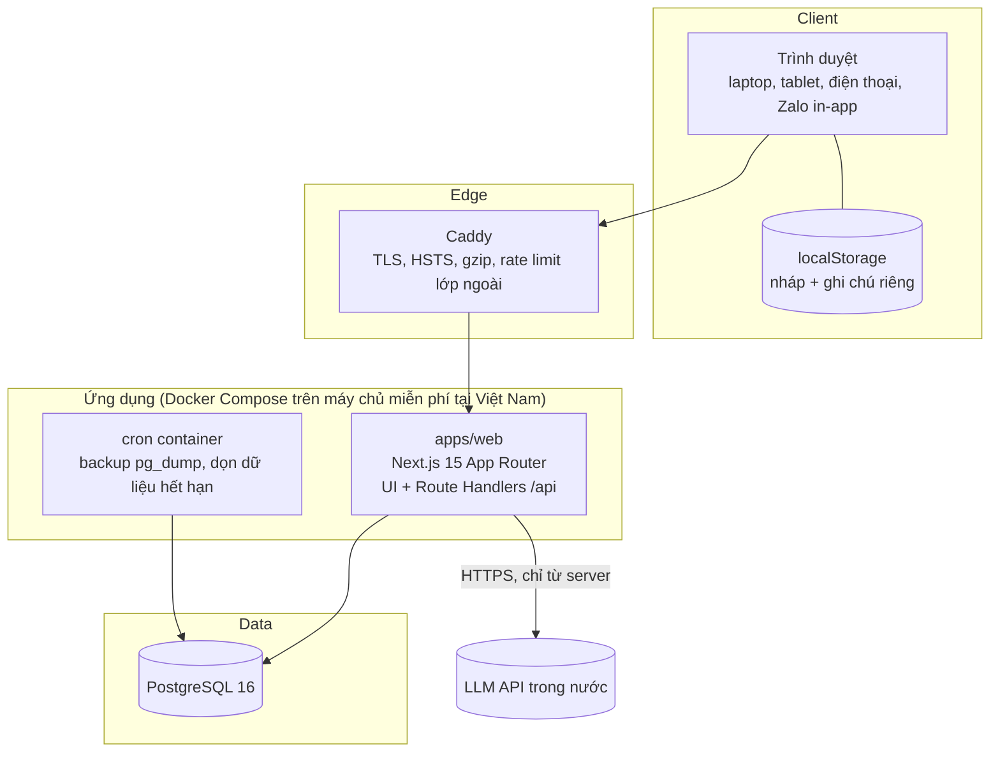
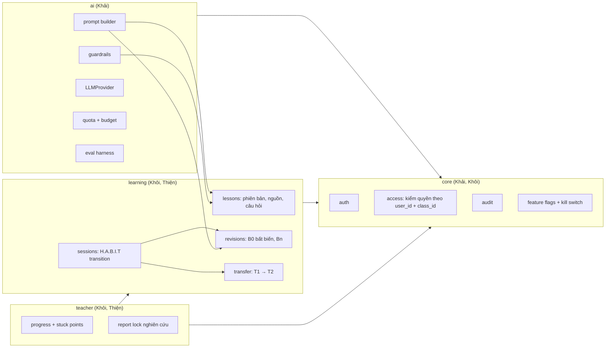
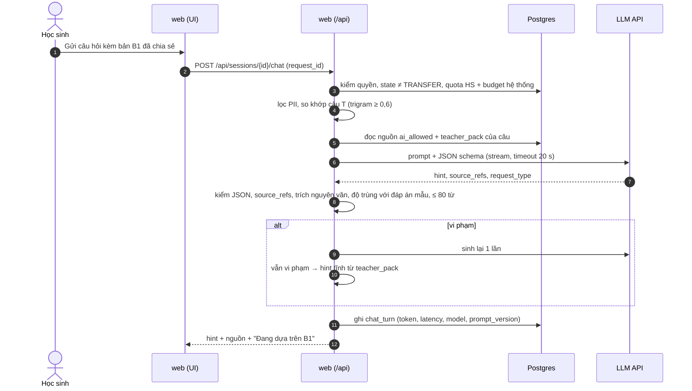
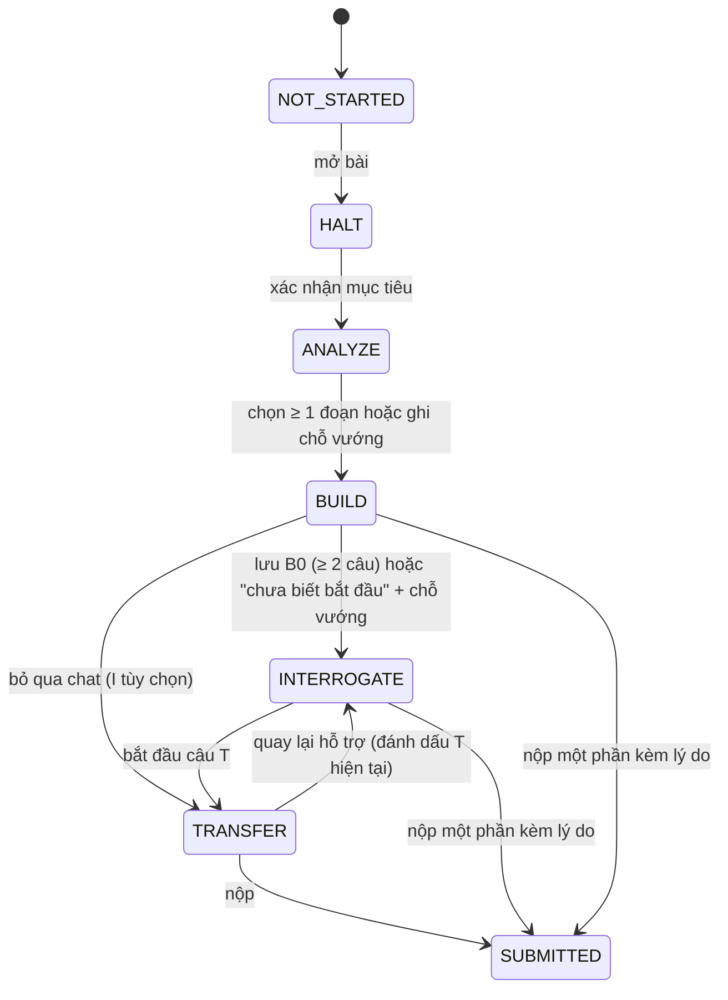

# 01 — Architecture Overview, ADR Log và Data Model

> **Phạm vi áp dụng:** MVP PreClass AI cho buổi thực địa 11/11/2026 và vòng thi 20/11/2026: gói bài L1 (L2 nếu kịp), luồng H.A.B.I.T, chatbot gợi ý có nguồn, dashboard giáo viên tối giản.
> **Nguyên tắc thiết kế xuyên suốt:** *build cho buổi 1, không chặn đường lên 4 bài và chế độ nghiên cứu đầy đủ*. Mọi chỗ để sẵn cho giai đoạn sau được đánh dấu **[pilot-ready]**.
> **Chưa chốt:** Q-01 (trần ngân sách), Q-02 (vùng xử lý và cam kết không huấn luyện của nhà cung cấp LLM).

---

## Phần A — Architecture Overview

### 1.1 Hệ thống làm gì

PreClass AI là không gian chuẩn bị bài Ngữ văn trước giờ học cho học sinh lớp 10 Trường THPT chuyên Lê Khiết. Bản MVP cho phép:

1. Học sinh đăng nhập bằng mã do trường cấp, nhận nhiệm vụ được giao.
2. Làm bài theo 5 bước H.A.B.I.T: Halt (xác định mục tiêu) → Analyze (chọn chi tiết) → Build (tự viết ý đầu tiên B0) → Interrogate (hỏi AI khi cần, tùy chọn) → Transfer (tự vận dụng, AI tạm dừng).
3. Hỏi AI và nhận gợi ý có trích dẫn đoạn văn giáo viên đã duyệt; AI không viết bài hộ.
4. Ghi chú riêng chỉ nằm trên thiết bị, không gửi AI, giáo viên hay nghiên cứu.
5. Giáo viên xem tiến độ lớp, bài làm B0 → Bn, đoạn chat và "chỗ vướng" của lớp.

### 1.2 Hệ thống KHÔNG làm gì ở MVP (out of scope)

| Không làm | Lý do / nguồn |
|---|---|
| Giáo viên tự soạn gói bài trên giao diện (T02) | Không kịp trước 09/11; nạp gói L1–L2 từ JSON seed |
| Chấm điểm tự động bài làm | Rubric do giáo viên chấm (tài liệu 03 nhóm nội dung) |
| Hint thích ứng theo năng lực học sinh | Cần dữ liệu sau buổi 1–2 |
| Xuất dữ liệu nghiên cứu, nhập điểm hậu kiểm (R01) | Cần sau 4 bài (~02/12) |
| Chatbot trả lời ngoài nguồn đã duyệt, tìm kiếm web | Rủi ro bịa nội dung (Tech Proposal v2, mục AI) |
| Native mobile app, PWA offline | Web responsive là đủ; xem ADR-0007 |
| Gắn nhãn MBTI, ADHD hoặc "mức lệ thuộc AI" cho học sinh | Không có cơ sở khoa học; dữ liệu nhạy cảm của trẻ em |
| Lưu ghi chú riêng trên máy chủ | Cam kết quyền riêng tư trong tài liệu 04, 06 nhóm nội dung |

### 1.3 Quality attributes — xếp hạng (khi xung đột, cái xếp trên thắng)

1. **Quyền riêng tư dữ liệu trẻ em** — học sinh lớp 10 phần lớn dưới 16 tuổi (Luật 91/2025/QH15, NĐ 356/2025).
2. **Tính toàn vẹn sư phạm** — B0 bất biến, AI không làm hộ, AI khóa ở bước T; đây là biến can thiệp của nghiên cứu.
3. **Không mất bài** — học sinh dùng điện thoại, mạng chập chờn, mở link trong Zalo.
4. **Tốc độ phát triển** — 3 dev, 4 ngày làm việc đến freeze 09/11.
5. **Chi phí** — gần 0 cố định; chi phí AI có trần cứng.
6. **Hiệu năng** — 1.000 tài khoản, cao điểm 100 người cùng lúc.

### 1.4 C4 Level 1 — System Context



**Ghi chú:** LLM không bao giờ nhận họ tên, mã nhóm nghiên cứu, ghi chú riêng, câu T, đề kiểm tra C1–C4 hay đề A/B.

### 1.5 C4 Level 2 — Containers



| Container | Công nghệ | Trách nhiệm | Owner |
|---|---|---|---|
| `apps/web` | Next.js 15, TypeScript strict, Tailwind, shadcn/ui, Drizzle | Giao diện 3 breakpoint, API, auth, H.A.B.I.T state machine, gọi LLM | Thiện (UI), Khôi (API, DB), Khải (AI, auth review) |
| PostgreSQL 16 | `pgcrypto`, `pg_trgm` | Dữ liệu học tập, quota, audit, eval | Khôi |
| Caddy | | TLS tự động, security header, rate limit lớp ngoài | Khải |
| cron | Alpine + `pg_dump` + `age` | Backup mã hóa 6 giờ/lần, xóa log hết hạn | Khải |

Không có Redis, object storage hay worker riêng: MVP không có upload file, quota đếm bằng Postgres, tải thấp (ADR-0001, ADR-0009).

### 1.6 C4 Level 3 — Module bên trong `apps/web`



**Quy tắc phụ thuộc (ép bằng `eslint-plugin-boundaries` trong CI):**

1. Chỉ module `ai/provider` được gọi LLM. Trình duyệt không bao giờ gọi LLM trực tiếp.
2. Chỉ module `learning/sessions` được đổi `learning_session.state`, và chỉ qua hàm SQL `habit_transition()`.
3. Không module nào đọc bảng `teacher_pack`, `transfer_item`, `assessment_form` để trả cho vai trò học sinh; `ai/prompt` được đọc `teacher_pack` để ghép prompt.
4. Mọi Route Handler gọi `requireUser()` + `access.*`; endpoint public phải đánh dấu `public: true` tường minh (deny by default).

### 1.7 Luồng chính

**(a) Học sinh hỏi AI ở bước I**



**(b) Học sinh vào bước T rồi xin quay lại hỗ trợ**

```mermaid
sequenceDiagram
    actor HS as Học sinh
    participant A as web (/api)
    participant DB as Postgres
    HS->>A: POST /api/sessions/{id}/transfer {action:start}
    A->>DB: habit_transition(TRANSFER) → cấp T1 chưa dùng
    HS->>A: POST /api/sessions/{id}/chat
    A-->>HS: 409 AI_PAUSED_IN_TRANSFER
    HS->>A: POST /transfer {action:return_support}
    A->>DB: đánh dấu T1 support_returned = true, state = INTERROGATE
    HS->>A: POST /transfer {action:start}
    A->>DB: cấp T2; hết câu → cho nộp kèm chỗ vướng
```

### 1.8 Cross-cutting concerns

| Chủ đề | Quyết định |
|---|---|
| Authn | Mã HS + mật khẩu do trường/team cấp (Auth.js Credentials, bcrypt cost 12); session cookie httpOnly; giáo viên dùng tài khoản riêng (ADR-0003) |
| Authz | Kiểm sở hữu (`user_id`) và lớp phụ trách (`class_id`) ở tầng service; trả 404 khi không có quyền (chống dò ID) |
| Audit | Ghi đăng nhập, mở báo cáo nghiên cứu, truy cập nội dung để xử lý sự cố, đổi cấu hình |
| Logging | JSON log có `requestId`; không ghi nội dung bài làm, tin nhắn, ghi chú |
| Lỗi API | RFC 9457 Problem Details, mã lỗi ổn định (`AI_PAUSED_IN_TRANSFER`, `QUOTA_EXCEEDED`, `B0_LOCKED`…) |
| Thời gian | Lưu UTC (`timestamptz`), hiển thị Asia/Ho_Chi_Minh |
| Feature flag | `ai.enabled` (kill switch → chỉ hint tĩnh), `research.report_locked`, `lesson.L2.enabled` |

### 1.9 Ràng buộc và giả định đang mở

| Mã | Giả định hiện tại | Nếu sai thì |
|---|---|---|
| A1 | GreenNode có model self-hosted Qwen 3.8 27B / Gemma 4 31B-IT xử lý tại VN (Q-02) | Dùng FPT AI Factory; nếu cả hai không xác nhận được thì ghi rủi ro mở, giữ PII filter |
| A2 | Máy chủ miễn phí ≥ 2 vCPU/4 GB đủ 100 người cùng lúc | k6 09/11 cho kết quả; xin máy mạnh hơn hoặc tắt staging trong giờ học |
| A3 | Trường gửi danh sách mã HS (không họ tên) trước 10/11 (Q-04) | Dùng 30 tài khoản mock cho buổi 1, nhập sau |
| A4 | Phiếu đồng ý phụ huynh hoàn tất trước 11/11 (Q-03) | Buổi 1 chỉ là thử luồng với HS đã đồng ý; còn lại dùng mock |
| A5 | Giáo viên duyệt gói L1 trước 06/11 12:00 | Chatbot chạy hint tĩnh, tắt LLM cho buổi 1 |

### 1.10 Hướng tiến hóa sau thực địa

| Giai đoạn sau cần | MVP đã chuẩn bị |
|---|---|
| 4 gói L1–L4 | `lesson_version` + seed JSON cùng cấu trúc |
| Giáo viên tự soạn bài (T02) | `teacher_pack`, `source_item` đã tách bảng, có `approved_by` |
| Chế độ nghiên cứu đầy đủ, xuất dữ liệu | `research_link` tách bảng, `assignment.study_mode`, `report_unlocked_at` **[pilot-ready]** |
| Hint thích ứng | `chat_turn.hint_level`, `step_evidence` lưu sẵn |
| Nhiều trường | `school_id` trên `class` **[pilot-ready]** |

---

## Phần B — ADR Log

**Quy ước:** file `docs/adr/NNNN-ten-ngan.md`, mẫu MADR rút gọn. Không sửa ADR đã Accepted; muốn đổi thì viết ADR mới với dòng "Supersedes".

| # | Tiêu đề | Status | Ngày |
|---|---|---|---|
| 0001 | Next.js full-stack monolith, không tách backend riêng | Proposed | 2026-11-06 |
| 0002 | PostgreSQL 16 + Drizzle, ràng buộc sư phạm viết thành constraint | Proposed | 2026-11-06 |
| 0003 | Đăng nhập bằng mã học sinh, không thu email/SĐT | Proposed | 2026-11-06 |
| 0004 | Ghi chú riêng chỉ trên thiết bị | Proposed | 2026-11-06 |
| 0005 | AI "teacher-authored first": LLM chỉ chọn và diễn đạt lại hint đã duyệt | Proposed | 2026-11-06 |
| 0006 | H.A.B.I.T là state machine phía máy chủ | Proposed | 2026-11-06 |
| 0007 | Responsive web 3 breakpoint, chat dạng bottom sheet trên điện thoại | Proposed | 2026-11-06 |
| 0008 | Gói bài dạng content-as-code (JSON seed) ở MVP | Proposed | 2026-11-06 |
| 0009 | Docker Compose trên máy chủ miễn phí tại Việt Nam, LLM trong nước; ngân sách chỉ cho API | Proposed | 2026-11-06 |

---

### ADR-0001 — Next.js full-stack monolith

- **Status:** Proposed · **Deciders:** Khải · **Consulted:** Khôi, Thiện

**Context.** 3 dev, 4 ngày đến freeze, tải thấp. Mọi màn hình dùng chung auth, session, lesson.

**Options.**
1. Next.js (UI) + NestJS (API) monorepo.
2. **Next.js full-stack: Route Handlers làm API, một image, một process.**
3. Next.js + Supabase (BaaS).

**Decision.** Chọn (2).

**Consequences.**
- (+) Một lần deploy, một runtime, type dùng chung không cần sinh code.
- (+) Không phải học NestJS trong 4 ngày.
- (−) Ít cấu trúc sẵn (guard, DI) → bù bằng lớp `access` bắt buộc và lint boundary.
- (−) Supabase (3) bị loại vì dữ liệu đặt ngoài Việt Nam và RLS gắn với Supabase Auth, khó chuyển.

**Revisit when:** có > 5 dev hoặc cần tách xử lý AI sang hàng đợi riêng.

---

### ADR-0002 — PostgreSQL 16 + Drizzle

- **Status:** Proposed

**Context.** Các quy tắc sư phạm phải được DB đảm bảo, không chỉ code: B0 không sửa được, một phiên mỗi học sinh mỗi lần giao, không gửi trùng.

**Options.** PostgreSQL + Prisma · **PostgreSQL + Drizzle** · SQLite.

**Decision.** PostgreSQL 16 + Drizzle ORM. Extension: `pgcrypto` (UUID), `pg_trgm` (so khớp câu T).

**Rules.**
- Migration sinh bằng `drizzle-kit generate`, commit cùng PR, **bắt buộc Khải review**.
- Partial unique index, CHECK, trigger chặn UPDATE viết bằng SQL trong migration.
- `attempt_revision`, `chat_turn`, `audit_log` là append-only: role DB của app không có quyền UPDATE/DELETE.

**Consequences.** (+) SQL gần với code, viết partial index và trigger dễ; (−) đội ít quen Drizzle hơn Prisma → Khải viết mẫu repository đầu tiên.

---

### ADR-0003 — Đăng nhập bằng mã học sinh

- **Status:** Proposed · **Related:** Q-03, Q-04, Luật 91/2025

**Context.** Học sinh phần lớn dưới 16 tuổi. Mỗi trường dữ liệu thu thêm là một nghĩa vụ pháp lý thêm.

**Options.** Google Workspace của trường (OIDC) · Email + mật khẩu · **Mã HS + mật khẩu do trường cấp**.

**Decision.** Mã HS dạng `LK10A1-07` + mật khẩu tạm, đổi ở lần đăng nhập đầu. Bảng nối mã ↔ họ tên do giáo viên giữ ngoài hệ thống. Giáo viên: tài khoản riêng, mật khẩu ≥ 12 ký tự. Rate limit đăng nhập 5 lần/15 phút/tài khoản.

**Consequences.** (+) Không thu email/SĐT; dữ liệu gửi LLM gần như không định danh. (−) Quên mật khẩu phải nhờ giáo viên đặt lại → có nút reset trong T01.

**Revisit when:** trường có Google Workspace cho học sinh và đồng ý dùng.

---

### ADR-0004 — Ghi chú riêng chỉ trên thiết bị

- **Status:** Proposed · **Related:** tài liệu 04, 06 nhóm nội dung (AC13, AC14)

**Decision.**
- Lưu trong `localStorage` theo khóa `note:{user_id}:{session_id}`; xóa khi đăng xuất.
- Không có bảng, cột, API, sự kiện analytics hay log nào chứa nội dung, độ dài hoặc thao tác gõ ghi chú.
- Dùng `localStorage` thay `sessionStorage` vì trình duyệt trong Zalo/Messenger hay bị hệ điều hành đóng tab.

**Consequences.** (+) Cam kết riêng tư kiểm chứng được bằng code review và test payload. (−) Mất thiết bị là mất ghi chú; ghi rõ trên giao diện.

---

### ADR-0005 — AI "teacher-authored first"

- **Status:** Proposed · **Owner:** Khải · **Related:** Bastani et al. 2025; Liu, Malan et al. 2025 (CS50); LearnLM & Eedi 2025

**Context.** Chatbot tự do có prompt cấm vẫn làm hộ (CS50: 22% phản hồi vẫn chứa code dù bị cấm). Bastani: GPT không rào chắn làm điểm thi giảm 17%; GPT có đáp án và hint của giáo viên trong prompt thì không gây hại.

**Options.**
1. Hint tĩnh hoàn toàn, không LLM.
2. LLM tự do có system prompt.
3. **Giáo viên soạn trước đáp án mẫu + hint ladder 3 mức + hiểu lầm phổ biến; LLM chọn mức và diễn đạt lại theo câu hỏi học sinh; code kiểm tra đầu ra; vi phạm thì dùng hint tĩnh.**

**Decision.** Chọn (3).
- Chỉ dùng model **self-hosted** trên nhà cung cấp trong nước (Qwen 3.8 27B hoặc Gemma 4 31B-IT); chọn bằng eval ~100 ca (tài liệu 02 mục 3.3).
- Tắt thinking mode; temperature 0,3–0,5; JSON schema có `request_type`, `hint_level`, `source_refs`.
- Guardrail bằng code: chặn ở bước T, so khớp câu T, độ trùng với đáp án mẫu, `source_refs` hợp lệ + trích nguyên văn, `hint` ≤ 80 từ, lọc PII.
- Kill switch `ai.enabled = false` → toàn bộ chuyển sang hint tĩnh.

**Consequences.** (+) Gợi ý luôn truy được về nội dung giáo viên duyệt; buổi thực địa vẫn chạy khi LLM sập. (−) Phụ thuộc nhóm nội dung soạn gói bài đúng hạn.

---

### ADR-0006 — H.A.B.I.T là state machine phía máy chủ

- **Status:** Proposed · **Related:** tài liệu 04, 06 nhóm nội dung (AC07, AC08)

**Decision.** `learning_session.state` chỉ đổi qua hàm SQL `habit_transition(session_id, action)`. Prompt và giao diện không quyết định mở/đóng bước. Gọi API chat khi `state = TRANSFER` → 409.

**Consequences.** (+) Ẩn nút trên UI không còn là biện pháp duy nhất; test được bằng gọi API trực tiếp. (−) Thêm bước mới cần migration.

---

### ADR-0007 — Responsive web, bottom sheet trên điện thoại

- **Status:** Proposed

**Context.** Tài liệu 06 nhóm nội dung yêu cầu hai khung cạnh nhau cả trên điện thoại. Ở 320 px mỗi khung còn ~130 px, khoảng 3–4 từ/dòng.

**Decision.** ≥ 768 px: hai khung cạnh nhau. < 768 px: khung bài toàn màn hình, chat là bottom sheet 40%/90%, nhãn "Đang dựa trên B…" luôn hiện trên thanh kéo. Ghi chú riêng thu thành chip 1 dòng.

**Consequences.** (+) Đọc được văn bản tự sự trên điện thoại. (−) Phải sửa câu chữ AC01 trong tài liệu 06 nhóm nội dung (Q-06).

---

### ADR-0008 — Gói bài dạng content-as-code

- **Status:** Proposed · **Owner:** Khôi

**Decision.** Nhóm nội dung (2 HS chuyên Văn, không có chuyên môn kỹ thuật) soạn trên **bảng tính mẫu**; Khôi chạy script chuyển sang `content/lessons/L{n}.json` theo schema Zod (nguồn có `paragraph_id`, câu hỏi, rubric, `teacher_pack`, câu T). Lệnh `pnpm seed` nạp vào DB và tạo `lesson_version` mới; không sửa phiên bản đã giao.

**Consequences.** (+) Không cần T02 trước 09/11; người soạn không phải dùng Git hay JSON. (−) Giáo viên chưa tự sửa được; mỗi lần sửa nội dung phải qua Khôi chạy lại script.

---

### ADR-0009 — Docker Compose trên máy chủ miễn phí tại Việt Nam

- **Status:** Proposed · **Related:** tài liệu 04, Q-01, Q-02

**Decision.** Image build ở GitHub Actions, đẩy GHCR, deploy bằng SSH + `docker compose pull && up -d`. Máy chủ miễn phí tại Việt Nam theo thứ tự: máy chủ trường → máy chủ lab → máy để bàn + Cloudflare Tunnel; thuê VPS chỉ khi Mentor/nhà trường tài trợ, vì ngân sách dự án chỉ dành cho API AI (file 03). Không dùng Vercel/Supabase ở bất kỳ môi trường nào có dữ liệu thật.

**Consequences.** (+) Dữ liệu học sinh không rời Việt Nam, không phát sinh hồ sơ chuyển dữ liệu xuyên biên giới. (−) Tự vận hành backup, HTTPS, cập nhật OS.

---

## Phần C — Data Model / ERD

### 3.1 Sơ đồ quan hệ

```mermaid
erDiagram
    SCHOOL ||--o{ CLASS : has
    CLASS ||--o{ MEMBERSHIP : has
    APP_USER ||--o{ MEMBERSHIP : "belongs to"
    APP_USER ||--o{ CONSENT_RECORD : gives
    LESSON ||--o{ LESSON_VERSION : versions
    LESSON_VERSION ||--o{ SOURCE_ITEM : contains
    LESSON_VERSION ||--o{ QUESTION : contains
    QUESTION ||--|| TEACHER_PACK : "guided by"
    LESSON_VERSION ||--o{ TRANSFER_ITEM : contains
    LESSON_VERSION ||--o{ ASSIGNMENT : "assigned as"
    CLASS ||--o{ ASSIGNMENT : receives
    ASSIGNMENT ||--o{ LEARNING_SESSION : has
    APP_USER ||--o{ LEARNING_SESSION : owns
    LEARNING_SESSION ||--o{ STEP_EVIDENCE : records
    LEARNING_SESSION ||--o{ ATTEMPT_REVISION : records
    LEARNING_SESSION ||--o{ CHAT_TURN : records
    LEARNING_SESSION ||--o{ TRANSFER_ATTEMPT : records
    LEARNING_SESSION ||--o| SUBMISSION : ends
    APP_USER ||--o{ USAGE_DAILY : counts
    APP_USER ||--o{ AUDIT_LOG : "actor of"
    APP_USER ||--o| RESEARCH_LINK : "coded as [pilot-ready]"
```

### 3.2 Đặc tả bảng

**Quy ước chung:** PK `id uuid DEFAULT gen_random_uuid()`; mọi bảng có `created_at timestamptz NOT NULL DEFAULT now()`; tên `snake_case`; enum lưu `text` + `CHECK`.

#### `app_user`
| Cột | Kiểu | Ràng buộc | Nhạy cảm |
|---|---|---|---|
| id | uuid | PK | — |
| login_code | citext | UNIQUE, dạng `LK10A1-07` | Internal |
| role | text | CHECK in (`STUDENT`,`TEACHER`,`RESEARCHER`,`ADMIN`) | — |
| password_hash | text | NOT NULL (bcrypt) | Secret |
| must_change_password | bool | default true | — |
| status | text | CHECK in (`ACTIVE`,`LOCKED`,`DISABLED`) | — |
| failed_login_count, locked_until | int, timestamptz | | — |

Không có cột họ tên, email, SĐT, ngày sinh.

#### `school`, `class`, `membership`
`school(code, name)` · `class(school_id, code '10A1', school_year '2026-2027')` · `membership(user_id, class_id, role_in_class STUDENT|TEACHER)`; `UNIQUE(user_id, class_id)`.

#### `consent_record`
| Cột | Ghi chú |
|---|---|
| user_id | |
| purpose | `APP_USE`, `RESEARCH`, `EXCERPT_PUBLICATION` |
| document_version | phiên bản thông tin tham gia |
| student_agreed_at | ô đồng ý trên web, không tích sẵn |
| guardian_form_id | mã phiếu giấy có chữ ký phụ huynh |
| withdrawn_at | |

#### `lesson`, `lesson_version`
`lesson(code 'L1', title)` · `lesson_version(lesson_id, version int, status DRAFT|APPROVED|RETIRED, mode PRECLASS|POSTCLASS, goal, habit_config jsonb, approved_by, approved_at, content_hash)`; `UNIQUE(lesson_id, version)`. Bản APPROVED không sửa (trigger chặn UPDATE nội dung).

#### `source_item`
`lesson_version_id, paragraph_id 'L1-P3', approved_text, kind TEXT|LESSON_NOTE|MEDIA_TRANSCRIPT, ai_allowed bool`; `UNIQUE(lesson_version_id, paragraph_id)`.

#### `question`, `teacher_pack`
`question(lesson_version_id, code 'L1-Q1', prompt, response_unit_id, rubric_ref)`.
`teacher_pack(question_id UNIQUE, model_answer, key_points jsonb, hint_l1, hint_l2, hint_l3, misconceptions jsonb, approved_by)` — **không bao giờ trả cho vai trò học sinh**.

#### `transfer_item`
`lesson_version_id, code 'T1'|'T2', prompt, order int` — không vào kho nguồn AI; dùng cho so khớp trigram.

#### `assignment`
`class_id, lesson_version_id, open_at, due_at, study_mode NORMAL|RESEARCH, config_snapshot jsonb, report_unlocked_at, report_unlocked_by`.

#### `learning_session`
| Cột | Kiểu | Ràng buộc |
|---|---|---|
| assignment_id, student_id | uuid FK | `UNIQUE(assignment_id, student_id)` |
| state | text | CHECK in (`NOT_STARTED`,`HALT`,`ANALYZE`,`BUILD`,`INTERROGATE`,`TRANSFER`,`SUBMITTED`) |
| current_question_id | uuid | |
| version | int | optimistic locking (`expected_version` → 409) |
| started_at, submitted_at | timestamptz | |

#### `step_evidence`
`session_id, step_code H|A|B|I|T, evidence jsonb (goal_ack, paragraph_ids[], stuck_note), status DONE|STUCK`; `UNIQUE(session_id, step_code, response_unit_id)`.

#### `attempt_revision` — append-only
| Cột | Ghi chú |
|---|---|
| session_id, response_unit_id | |
| kind | `B0`, `BN`, `T` |
| parent_id | bản trước |
| content | text |
| unsure | bool (chưa biết bắt đầu / chưa chắc) |
| shared_with_ai_at | null nếu chưa chia sẻ |
| request_id | UNIQUE |

Index: `UNIQUE(session_id, response_unit_id) WHERE kind = 'B0'` — mỗi đơn vị trả lời chỉ một B0.

#### `chat_turn` — append-only
`session_id, question_id, intent, shared_revision_id, message_redacted, hint, hint_level 0–3, source_refs text[], request_type, guard_result OK|REGENERATED|FALLBACK|BLOCKED_T|BLOCKED_PAYLOAD, model, prompt_version, tokens_in, tokens_out, latency_ms, request_id UNIQUE, reported_wrong_at`.

#### `transfer_attempt`
`session_id, transfer_item_id, status STARTED|SUBMITTED|ABANDONED, support_returned bool, revision_id`; `UNIQUE(session_id, transfer_item_id)` — không tái dùng câu T.

#### `submission`
`session_id UNIQUE, revision_ids uuid[], partial bool, missing_steps text[], reason, submitted_at, late bool`.

#### `usage_daily`, `system_budget`
`usage_daily(user_id, day date, ai_calls int, tokens_in, tokens_out)`; `PRIMARY KEY(user_id, day)`; cập nhật bằng `INSERT … ON CONFLICT DO UPDATE` trong transaction.
`system_budget(day PRIMARY KEY, tokens_out_limit, tokens_out_used)` — vượt → `ai.enabled` coi như false trong ngày.

#### `alert`
`session_id, reason NOT_SUBMITTED|MISSING_STEP|FULL_ANSWER_REQUESTS|OFF_TASK|NEED_TEACHER|AI_REPORTED_WRONG, state NEW|VIEWING|RESPONDED|CLOSED, dedup_key UNIQUE, reviewed_by`.

#### `audit_log` — append-only
`id bigserial, occurred_at, actor_id, actor_role, action (LOGIN, LOGIN_FAILED, REPORT_UNLOCK, CONTENT_ACCESS_FOR_INCIDENT, PASSWORD_RESET, FLAG_CHANGE, SEED_LESSON), resource_type, resource_id, request_id, metadata jsonb (không chứa nội dung học sinh)`.

#### `eval_case`, `eval_result`
`eval_case(code, group, question_id, student_message, shared_revision_text, expected_behavior)` · `eval_result(case_id, model, prompt_version, output jsonb, guard_result, rater_id, scores jsonb 6 chiều, latency_ms)`.

#### `research_link` **[pilot-ready]**
`user_id UNIQUE, research_code, pair_id, group_assigned PRECLASS|COMPARISON, form_order AB|BA` — quyền đọc chỉ vai trò `RESEARCHER`; không bao giờ vào prompt AI.

#### `feature_flag`
`key UNIQUE, enabled, updated_by, updated_at`.

### 3.3 Máy trạng thái phiên học (MVP)



| Chuyển trạng thái | Ai được làm |
|---|---|
| Mọi chuyển trong phiên | Chủ phiên (học sinh) qua `habit_transition()` |
| Mở lại phiên đã nộp | Giáo viên phụ trách lớp, có audit |
| Đổi cấu hình giữa chừng | Không ai trong chế độ RESEARCH |

### 3.4 Bảng phân loại dữ liệu

| Mức | Ví dụ | Xử lý bắt buộc |
|---|---|---|
| Public | Trang đăng nhập | — |
| Internal | Mã HS, mã bài, trạng thái phiên | Cần đăng nhập |
| Personal (học tập) | B0, Bn, câu T, tin nhắn chat, ghi chú GV | Chỉ chủ thể + GV lớp phụ trách; không ghi vào log |
| **Restricted** | `teacher_pack`, `transfer_item`, đề C1–C4, đề A/B, `research_link` | Không có đường đọc từ vai trò học sinh; không gửi LLM (trừ `teacher_pack`) |
| **Device-only** | Ghi chú riêng | Không tồn tại trên máy chủ |
| Secret | Mật khẩu hash, API key LLM, khóa backup | Không trả qua API; nằm ngoài DB |

---

## Phần D — Checklist review (dùng trong design review #1)

- [ ] Mọi mũi tên trong sơ đồ có nhãn và chiều đi.
- [ ] Mỗi quyết định lớn có ADR với ≥ 2 phương án.
- [ ] B0 bất biến, một phiên/HS/lần giao, không gửi trùng đã thành constraint DB.
- [ ] Không bảng/cột nào chứa ghi chú riêng.
- [ ] Không đường API nào trả `teacher_pack`, `transfer_item` cho học sinh.
- [ ] Mọi chỗ còn OPEN trỏ về Q-xx.

## Phần E — Task phát sinh

| ID | Task | Owner | Hạn |
|---|---|---|---|
| T1-01 | Review tài liệu này, chuyển ADR 0001–0006 sang Accepted | Khải, Khôi, Thiện | 06/11 |
| T1-02 | Tách mỗi ADR thành file riêng trong `docs/adr/` | Khôi | 07/11 |
| T1-03 | Viết Drizzle schema theo mục 3.2 + migration đầu tiên + seed giả | Khôi | 06/11 |
| T1-04 | Cấu hình `eslint-plugin-boundaries` cho quy tắc 1.6 | Khải | 07/11 |
| T1-05 | Bảng tính mẫu cho nhóm nội dung + schema Zod + script bảng tính → JSON | Khôi | 06/11 09:00 |
| T1-06 | Chị Hiển, anh Khang góp ý mục 1.1–1.2 và luồng 1.7 từ góc nhìn EdTech | chị Hiển, anh Khang | 07/11 |
