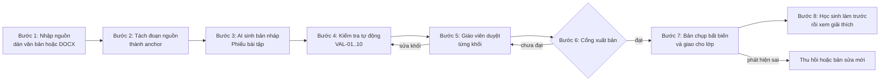
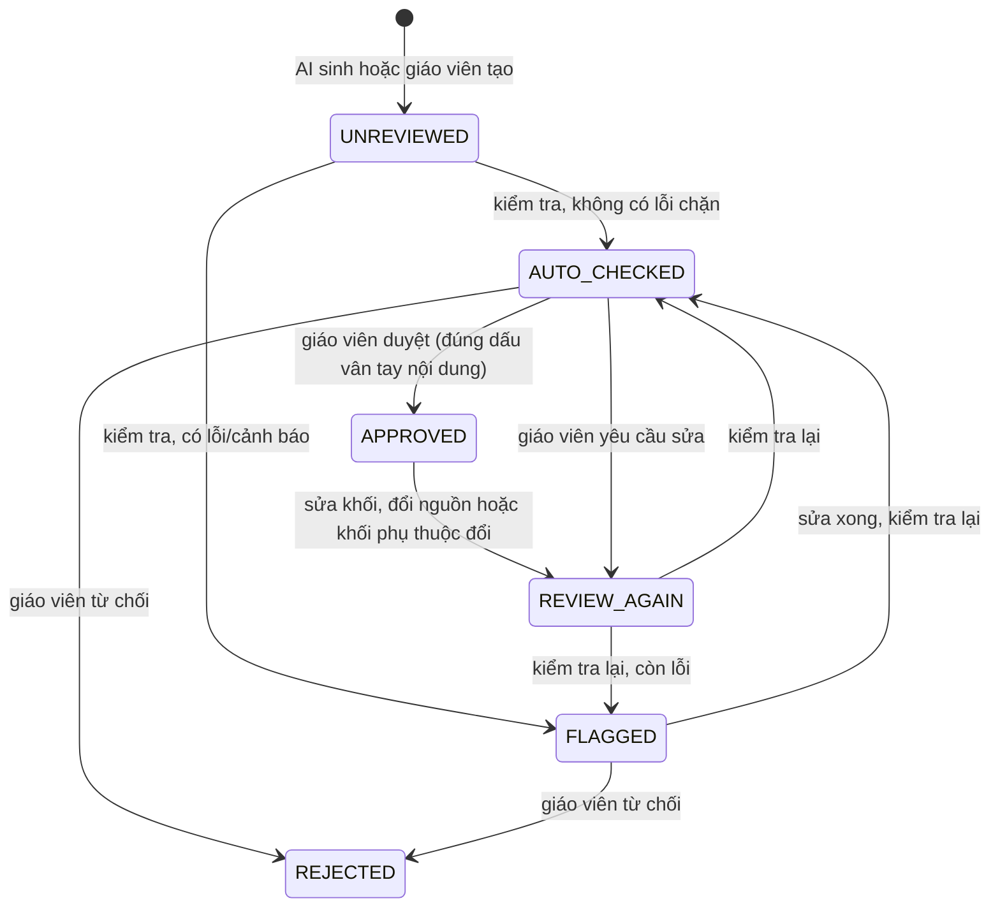
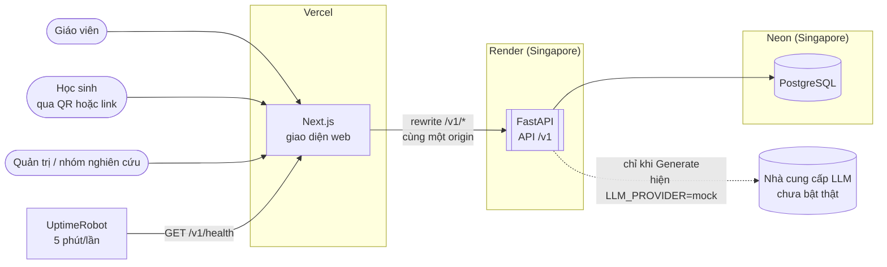
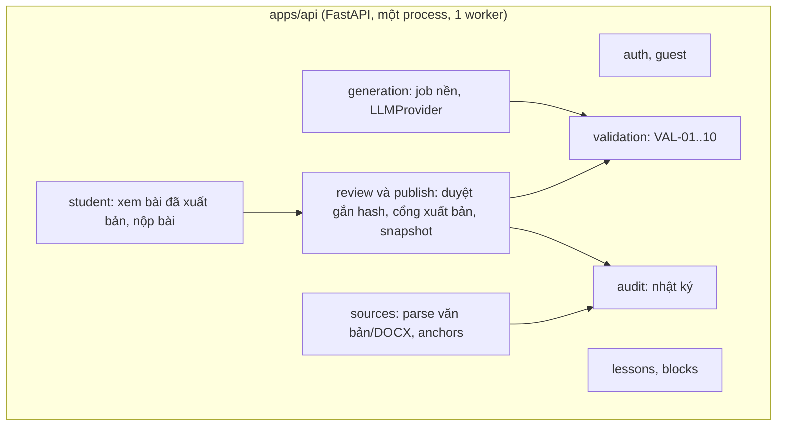
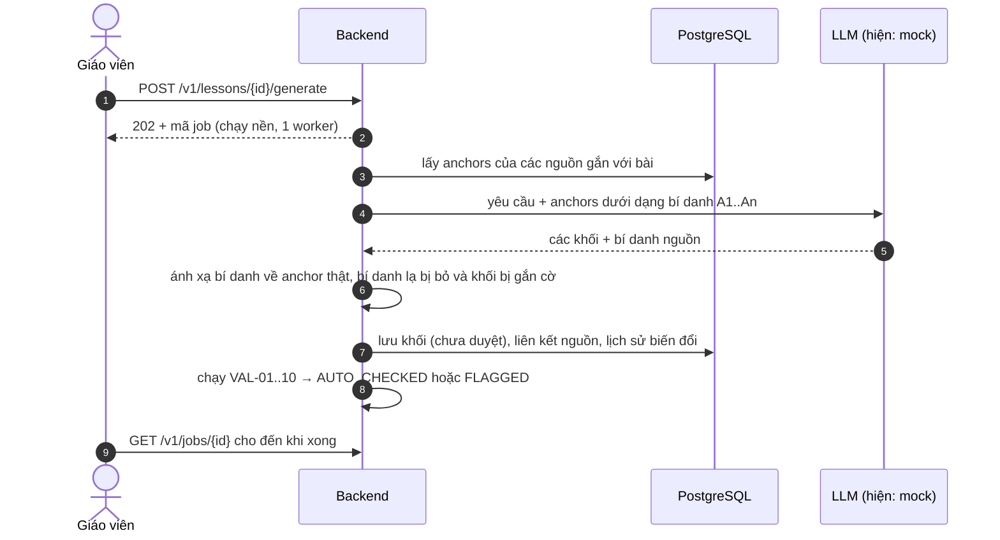
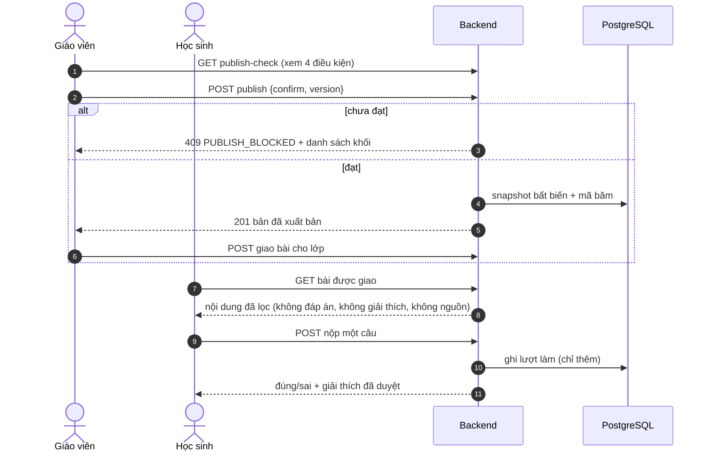

# PreClass AI — Hồ sơ đề tài (Proposal)

> **Học liệu Địa lí có AI hỗ trợ, truy vết được nguồn, giáo viên duyệt từng khối**
>
> Trạng thái: **bản nháp v0.1 cho nhóm chốt** · Ngày: 2026-11-20
> Quy ước đánh dấu trong tài liệu: **[CHỜ DỮ LIỆU — điền sau buổi khảo sát]** = chưa có kết quả; **[CẦN TRÍCH DẪN]** = cần nhóm bổ sung tài liệu tham khảo thật; **[ẢNH: tên màn]** = cần chụp màn hình; **[NHÓM CHỐT]** = quyết định chưa được đưa ra.

---

## 0. Thông tin đề tài

| Mục | Nội dung |
|---|---|
| Tên sản phẩm | PreClass AI |
| Đơn vị | Trường THPT chuyên Lê Khiết |
| Lĩnh vực | Giáo dục — ứng dụng AI trong dạy học Địa lí THPT (lớp 10–11) |
| Loại hình | Sản phẩm phần mềm kèm nghiên cứu thăm dò (pilot) |
| Phiên bản tài liệu | v0.1 (bản nháp), 2026-11-20 |
| Sản phẩm trực tuyến | https://pre-class-ai.vercel.app |
| Mã nguồn | Kho `preclass-ai/PreClassAI` (backend `apps/api`, frontend `apps/web`) |

**Nhóm thực hiện** (theo `docs/v2/PreClass_Backend_Plan_v2.md` và lịch sử commit):

| Thành viên | Vai trò |
|---|---|
| Khải | Trưởng nhóm kỹ thuật; backend, cơ sở dữ liệu, tích hợp AI, triển khai cloud |
| Thiện | Frontend (giao diện giáo viên, học sinh, quản trị) |
| Giáo viên hướng dẫn | **[NHÓM CHỐT — điền họ tên và vai trò]** |
| Thành viên khác (nếu có) | **[NHÓM CHỐT — điền]** |

Ngoài hai thành viên trên, nhóm có dùng các trợ lý lập trình AI (Claude Code và các công cụ tương tự) để viết và rà soát mã; mọi thay đổi vẫn đi qua pull request và kiểm thử (xem `AGENTS.md`).

---

## 1. Tóm tắt

Giáo viên Địa lí có thể nhờ AI soạn nhanh học liệu trước giờ học, nhưng AI đôi khi đưa ra số liệu sai hoặc không rõ nguồn (hiện tượng "hallucination" — mô hình tạo nội dung nghe hợp lí nhưng không có thật). Với Địa lí, nơi bảng thống kê, đơn vị, năm và vùng là cốt lõi, lỗi như vậy dễ lọt qua mắt người đọc. PreClass AI thử nghiệm một quy trình khác: AI chỉ **soạn bản nháp**; hệ thống gắn **từng khối nội dung với đoạn nguồn gốc** mà giáo viên cung cấp, **tự đối chiếu bằng quy tắc xác định** (nguyên văn, số liệu, đáp án), rồi **giáo viên duyệt từng khối** trước khi học sinh nhìn thấy. Học sinh **tự làm trước, xem giải thích đã duyệt sau**. Bản hiện tại chạy trên cloud miễn phí với dữ liệu minh họa và AI ở chế độ mô phỏng (`mock`). Nhóm dự kiến đánh giá bước đầu bằng dữ liệu làm bài ẩn danh (mã `KS-XXXX`), phiếu khảo sát khả năng sử dụng (SUS) và cảm nhận của học sinh, cùng một nhiệm vụ duyệt bài thử với giáo viên (nếu nhóm quyết định làm). Kết quả: **[CHỜ DỮ LIỆU — điền sau buổi khảo sát]**.

---

## 2. Đặt vấn đề

### 2.1 Bối cảnh

- Giáo viên Địa lí cần chuẩn bị học liệu (phiếu bài tập, thẻ ghi nhớ) **trước giờ học**, thường từ tài liệu có sẵn như đoạn văn và bảng số liệu trong sách, báo cáo thống kê.
- Các công cụ AI tạo sinh có thể rút ngắn thời gian này, nhưng sản phẩm của chúng **có thể sai** mà vẫn trôi chảy, và người dùng khó biết sai ở đâu.
- Địa lí đặc biệt nhạy với **số liệu**: một con số lệch năm, lệch đơn vị hoặc gán nhầm vùng làm sai cả câu hỏi và đáp án.

### 2.2 Khoảng trống

Theo hiểu biết của nhóm, nhiều công cụ AI soạn bài cho giáo viên trả về văn bản hoàn chỉnh nhưng **ít cho giáo viên thấy từng nội dung lấy từ đâu và AI đã biến đổi nó thế nào** (chép nguyên văn, diễn đạt lại, tổng hợp hay tự đề xuất). Nhận định này là **giả định của nhóm**, chưa được khảo sát có hệ thống: **[CẦN TRÍCH DẪN — khảo sát công cụ hiện có]**. Khi không thấy được nguồn, việc "duyệt" của giáo viên dễ trở thành đọc lướt.

---

## 3. Mục tiêu và câu hỏi nghiên cứu

### 3.1 Mục tiêu

**Mục tiêu tổng quát.** Xây dựng và đánh giá bước đầu một quy trình AI hỗ trợ soạn học liệu Địa lí trong đó mỗi khối nội dung đều truy vết được tới nguồn, được kiểm tra tự động và được giáo viên duyệt có trách nhiệm.

**Mục tiêu cụ thể.**

1. Xây dựng hệ thống chạy được: nhập nguồn → sinh bản nháp → kiểm tra → duyệt từng khối → xuất bản bất biến → giao lớp → học sinh làm bài. *(Đã có, xem mục 5–6.)*
2. Thu thập dữ liệu hành vi ẩn danh của học sinh khi làm bài. *(Cơ chế đã có; dữ liệu chưa thu.)*
3. Đo cảm nhận của học sinh về tính dễ dùng và cách học "làm trước, xem giải thích sau". *(Phiếu đã soạn, chưa phát.)*
4. Tìm hiểu, ở quy mô nhỏ, liệu cơ chế truy vết giúp giáo viên phát hiện lỗi nội dung. *(Đề xuất, nhóm chốt.)*

### 3.2 Câu hỏi nghiên cứu (đề xuất, nhóm chốt)

| RQ | Câu hỏi | Biến đo chính | Công cụ |
|---|---|---|---|
| **RQ1** *(đề xuất, nhóm chốt)* | Cơ chế truy vết nguồn + duyệt từng khối có hỗ trợ giáo viên phát hiện lỗi trong nội dung AI không? | Số lỗi cài sẵn được phát hiện / tổng số lỗi; thời gian duyệt; điểm SUS của giáo viên | Nhiệm vụ duyệt bài (mục 8.3c) |
| **RQ2** *(đề xuất, nhóm chốt)* | Học sinh đánh giá thế nào về cách học "tự làm trước, xem giải thích đã duyệt sau" (dễ dùng, hữu ích, mức tin tưởng)? | Điểm SUS; điểm Likert L1–L6 | Phiếu học sinh (Phụ lục C) |
| **RQ3** *(đề xuất, nhóm chốt)* | Kết quả làm bài lần đầu theo kỹ năng Địa lí (đọc bảng, so sánh, tính toán, giải thích) phân bố ra sao? | Tỉ lệ đúng lần đầu theo kỹ năng | Dữ liệu hành vi theo mã KS |

> **Lưu ý khả thi cho RQ3 (cần nhóm quyết định).** Hệ thống có 4 nhãn kỹ năng (`READ_TABLE`, `COMPARE`, `CALCULATE`, `EXPLAIN`; `apps/api/app/schemas.py`), nhưng bài khảo sát hiện có (`dan-so-vung`) chỉ có **2 câu**: câu 1 trắc nghiệm kỹ năng `COMPARE`, câu 2 nhập số kỹ năng `CALCULATE` (`apps/api/seed/seed.py`, hàm `build_blocks`). Tệp CSV xuất ra cũng **chưa có cột kỹ năng** (chỉ `Câu 1`, `Câu 2`). Vì vậy, nếu giữ bài hiện tại, RQ3 chỉ so sánh được hai kỹ năng; muốn phủ cả 4 kỹ năng cần thêm câu hỏi (và nên thêm cột kỹ năng vào CSV). **[NHÓM CHỐT]**

### 3.3 Giả thuyết (nếu phù hợp)

Vì đây là nghiên cứu thăm dò, không có nhóm đối chứng, nhóm đề xuất dùng **giả thuyết mô tả** thay cho giả thuyết kiểm định:

- H2: điểm SUS trung bình của học sinh nằm ở mức chấp nhận được; phần lớn học sinh đồng ý rằng lời giải thích sau khi nộp giúp hiểu bài (L1).
- H3: tỉ lệ đúng lần đầu ở câu tính toán thấp hơn câu so sánh (giả thuyết khai thác; có thể bị bác bỏ).
- H1: giáo viên phát hiện phần lớn lỗi cài sẵn khi dùng giao diện truy vết.

Ngưỡng cụ thể cho "chấp nhận được", "phần lớn": **[NHÓM CHỐT]**. Các giả thuyết trên **chưa có dữ liệu kiểm tra**.

---

## 4. Tổng quan ngắn

Phần này chỉ nêu khái niệm; tài liệu tham khảo cần nhóm bổ sung.

- **AI trong giáo dục.** Mô hình ngôn ngữ lớn (LLM — large language model) được dùng để soạn đề, tóm tắt, gợi ý. **[CẦN TRÍCH DẪN]**
- **Hallucination của LLM.** Mô hình có thể sinh thông tin sai nhưng trình bày tự tin, kể cả số liệu và trích dẫn. **[CẦN TRÍCH DẪN]**
- **Provenance (truy vết nguồn gốc).** Ghi lại một nội dung bắt nguồn từ đâu và đã bị biến đổi thế nào, để người dùng kiểm chứng được. **[CẦN TRÍCH DẪN]**
- **Human-in-the-loop (con người trong vòng lặp).** Quyết định cuối cùng thuộc về người, hệ thống chỉ hỗ trợ và ghi lại trách nhiệm. **[CẦN TRÍCH DẪN]**
- **Retrieval practice (học bằng tự kiểm tra).** Việc cố nhớ/giải trước khi xem đáp án thường được cho là giúp ghi nhớ tốt hơn xem lại thụ động. **[CẦN TRÍCH DẪN]** Đây là cơ sở cho thiết kế "làm trước, xem giải thích sau"; bản thân PreClass AI **chưa kiểm chứng** hiệu quả này.
- **SUS (System Usability Scale).** Thang 10 câu đo khả năng sử dụng, điểm 0–100. **[CẦN TRÍCH DẪN]**

---

## 5. Giải pháp: PreClass AI

### 5.1 Ý tưởng cốt lõi

> **AI tạo bản nháp → hệ thống đối chiếu nguồn → giáo viên duyệt bản cuối.**

Hai điểm cần nhớ:

1. **AI không bao giờ tự duyệt.** Mọi khối do AI tạo bắt đầu ở trạng thái chưa duyệt; chỉ giáo viên (qua giao diện) mới chuyển được sang "đã duyệt".
2. **"Truy được nguồn" ≠ "đúng".** Một khối có liên kết nguồn chỉ cho biết nó *dựa vào đâu*, không bảo đảm lập luận đúng. Vì vậy liên kết nguồn, kết quả kiểm tra tự động và quyết định duyệt của giáo viên được lưu **ở các bảng riêng**, không gộp làm một.



### 5.2 Các nguyên tắc PR-01..PR-08

Nguồn: `docs/v2/CLAUDE_CODE_PROMPT_Backend_v2.md` (bảng nguyên tắc). Giải thích bằng lời thường:

| Mã | Nguyên tắc | Nghĩa là gì |
|---|---|---|
| PR-01 | Nguồn ≠ đúng | Có nguồn chưa chắc đúng; liên kết nguồn, kết quả kiểm tra và quyết định duyệt là ba thứ khác nhau, lưu riêng. |
| PR-02 | Giáo viên duyệt thực chất | Chỉ giáo viên (hoặc người được giao) duyệt; mỗi lần duyệt gắn với **dấu vân tay của nội dung** lúc duyệt; không có nút "duyệt tất cả". |
| PR-03 | Bằng chứng trước | Khối nêu sự kiện/số liệu phải có nguồn hợp lệ, nếu không sẽ bị gắn cờ và chặn xuất bản. |
| PR-04 | Sửa được | Chữ, số liệu, nhãn, đáp án là dữ liệu có cấu trúc, không "đóng" trong ảnh nên giáo viên sửa được. |
| PR-05 | Bản xuất bản bất biến | Bản đã xuất bản là bản chụp không sửa được (cơ sở dữ liệu chặn); muốn sửa phải tạo bản mới. |
| PR-06 | Máy chủ tự xác minh nguồn | Hệ thống **không tin** mã nguồn do AI trả về; tự kiểm tra mã đó có tồn tại và thuộc đúng tài liệu của bài. |
| PR-07 | Số liệu Địa lí | Mọi con số trong khối (trừ năm và số thứ tự nhỏ) phải xuất hiện trong đoạn nguồn được liên kết; khối "dữ kiện số liệu" phải có đủ giá trị, đơn vị, thời kỳ, vùng. |
| PR-08 | Học sinh không thấy phần nội bộ | Trước khi học sinh nộp một câu, máy chủ **không gửi** đáp án, giải thích, nguồn, trạng thái duyệt của câu đó. |

### 5.3 Kiểm tra tự động VAL-01..10

Nguồn: `docs/v2/CLAUDE_CODE_PROMPT_Backend_v2.md` mục 8 và `apps/api/app/validation/__init__.py`. "Chặn" nghĩa là khối còn lỗi này thì không xuất bản được; "Cảnh báo" chỉ nhắc giáo viên.

| Mã | Phát hiện gì | Mức độ | Ví dụ Địa lí |
|---|---|---|---|
| VAL-01 | Mã nguồn (anchor) không tồn tại hoặc không thuộc tài liệu của bài | Chặn | AI trích "ô r5c1" nhưng bảng chỉ có 4 dòng |
| VAL-02 | Khối đánh dấu "nguyên văn" nhưng không khớp đúng văn bản nguồn (chuẩn hóa Unicode, giữ dấu tiếng Việt) | Chặn | Câu trích bị đổi một từ, mất dấu "ơ" |
| VAL-03 | Khối nêu sự kiện không có nguồn hợp lệ và không có lí do; hoặc có số không nằm trong nguồn được liên kết | Chặn | Khối ghi "Tây Nguyên 6,1 triệu người" trong khi nguồn ghi 5,9 |
| VAL-04 | Câu trắc nghiệm không có đúng 1 đáp án đúng; đáp án trỏ tới lựa chọn không có; câu nhập số thiếu giá trị/đơn vị | Chặn | Hai phương án cùng được đánh dấu đúng |
| VAL-05 | Nhãn lựa chọn A–D trùng hoặc thiếu | Cảnh báo (Chặn nếu thiếu phương án đúng) | Hai phương án cùng nhãn "B" |
| VAL-06 | Khối đã duyệt nhưng nội dung (hoặc nguồn) đã đổi sau khi duyệt | Chặn | Sửa đáp số sau khi đã bấm duyệt |
| VAL-07 | Kiểm tra ảnh/bản đồ | Chưa làm (chỗ giữ chỗ, luôn đạt) | — |
| VAL-08 | Thuật ngữ nghi vấn theo danh sách | Cảnh báo | Câu "Việt Nam không có biển". **Danh sách hiện chỉ có 3 mục mẫu** (`glossary_geo.txt`), cần bộ môn bổ sung |
| VAL-09 | Nguồn dùng chung trong trường thiếu ghi chú giấy phép/nguồn gốc | Chặn | Bảng số liệu chia sẻ không ghi nguồn |
| VAL-10 | Học sinh đọc được đáp án của một câu từ chính nội dung hiển thị trước khi nộp: số đáp án xuất hiện ở khối khác, đoạn văn nêu phương án đúng kèm "lớn nhất/đứng đầu", chỉ phương án đúng được nêu ở các số liệu; (Cảnh báo) từ chỉ có ở phương án đúng trong câu xếp hạng, hoặc câu/đoạn khác chỉ nêu một phần phương án gồm đáp án | Chặn / Cảnh báo | Đoạn "nhóm dịch vụ chiếm tỉ trọng lớn nhất" trong khi đáp án là Dịch vụ |

Ngoài ra, các đáp số dẫn xuất (hiệu, tổng, tỉ lệ) được **tính lại** từ ô nguồn bằng số thập phân chính xác và đối chiếu với đáp số trong khối (hàm `derive`, `apps/api/app/validation/__init__.py`).

**Giới hạn:** các quy tắc này kiểm tra **tính nhất quán hình thức** (khớp văn bản, khớp số). Chúng không đánh giá lập luận sư phạm có hay không; phần đó thuộc về giáo viên.

### 5.4 Trạng thái duyệt khối và cổng xuất bản

Mỗi khối có một trạng thái duyệt (ràng buộc trong cơ sở dữ liệu: `UNREVIEWED`, `AUTO_CHECKED`, `FLAGGED`, `APPROVED`, `REVIEW_AGAIN`, `REJECTED`; `apps/api/alembic/versions/0001_schema.sql`).



Các điểm đáng chú ý (nguồn: `apps/api/app/publish/__init__.py`, `.agents/PROGRESS.md`):

- Quyết định duyệt gửi kèm `contentHash` (dấu vân tay nội dung đang hiển thị); nếu nội dung đã đổi, máy chủ trả `409 STALE_REVIEW`.
- Duyệt khối có lỗi chặn bị từ chối (`409 APPROVE_BLOCKED`).
- Sửa một khối làm các khối phụ thuộc (ví dụ đáp án, giải thích của một câu hỏi) phải duyệt lại.
- Vai trò người duyệt thứ hai (`REVIEWER`) có trong hệ thống nhưng **tắt mặc định** (`REVIEWER_ENABLED=false`).

**Cổng xuất bản** (`_gate`, `apps/api/app/publish/__init__.py`) gồm 4 điều kiện, cộng với việc giáo viên **xác nhận đã kiểm tra**:

1. `ALL_APPROVED` — mọi khối đã duyệt và duyệt còn hiệu lực;
2. `NO_BLOCKERS` — không còn lỗi chặn;
3. `SOURCES_VALID` — mọi liên kết nguồn hợp lệ;
4. `HAS_ITEMS` — có ít nhất một câu hỏi hoặc thẻ.

Đạt đủ thì hệ thống tạo **bản chụp bất biến** (snapshot) kèm mã băm; bản cũ chuyển sang trạng thái "bị thay thế". Có thể **thu hồi** bản đã xuất bản (học sinh khi đó nhận `410 WITHDRAWN`).

### 5.5 Trải nghiệm học sinh

- Học sinh chỉ thấy **nội dung đã duyệt, đã lọc**: đề, các phương án. Không có đáp án, giải thích, nguồn nội bộ, trạng thái duyệt hay kết quả kiểm tra (PR-08; test riêng trong `apps/api/tests/integration/test_student.py`).
- Học sinh nộp **một lần cho mỗi câu**; sau khi nộp mới nhận kết quả đúng/sai và lời giải thích đã duyệt. Bảng lưu lượt làm bài là **chỉ-thêm** ở mức cơ sở dữ liệu nên không sửa/xóa được từng lượt.
- Học sinh gọi các API nguồn gốc/duyệt sẽ nhận `404` hoặc `403`.

### 5.6 Chế độ khách và mã khảo sát `KS-XXXX`

Để khảo sát **ẩn danh** quy mô lớp mà không phải tạo tài khoản, hệ thống có chế độ khách (`apps/api/app/guest/__init__.py`):

- Mỗi lượt vào tạo một tài khoản học sinh tạm, định danh **chỉ bằng mã** dạng `KS-` + 4 kí tự ngẫu nhiên (bỏ các kí tự dễ nhầm `0`, `O`, `1`, `I`). Không thu tên, email, số điện thoại; IP chỉ dùng trong bộ nhớ để giới hạn tốc độ, **không ghi vào cơ sở dữ liệu**.
- Khách chỉ vào **lớp khảo sát `KS`**, lớp này **chỉ được giao bài mẫu đã xuất bản** (hiện là 1 bài: "Phân bố dân cư theo vùng", `apps/api/seed/survey.py`, `seed/lessons.py`).
- Đóng trang có thể vào lại bằng mã (sai quá 5 lần/15 phút bị khóa tạm). Phiên khách có hiệu lực 14 ngày (`guest_session_days`).
- Liên kết/mã QR dành cho học sinh: `/thu?bai=dan-so-vung`.
- Quản trị bật/tắt chế độ này bằng `GUEST_ACCESS_ENABLED`.

---

## 6. Kiến trúc kỹ thuật

### 6.1 Tóm tắt cho người không chuyên

Hệ thống có ba phần: **trang web** (giao diện thầy cô và học sinh dùng trên trình duyệt), **máy chủ xử lí** (kiểm tra, lưu, duyệt), và **cơ sở dữ liệu** (nơi lưu mọi thứ). Điểm khác biệt là nhiều quy tắc "không được phép" (ví dụ: không sửa bản đã xuất bản, không xóa lượt làm bài) được **khóa ngay trong cơ sở dữ liệu**, nên dù phần mềm có lỗi cũng khó vi phạm.

### 6.2 Sơ đồ hệ thống (hiện tại, bản cloud demo)



Nguồn: `docs/adr/ADR-0011-cloud-demo-deploy.md`, `render.yaml`, `apps/web/next.config.ts`. Học sinh không bao giờ gọi trực tiếp LLM; AI chỉ chạy khi giáo viên bấm Generate. Ngoài cloud, repo còn cấu hình Docker Compose (Caddy + web + api + Postgres) cho staging/prod (`infra/`, `docs/operations/RUNBOOK.md`).

### 6.3 Module backend (chi tiết cho người chuyên)



Quy ước (`CLAUDE.md`, "Backend architecture"): router mỏng, logic nằm ở các gói `app/*`; chỉ `generation` gọi LLM; AI không bao giờ đặt trạng thái duyệt; lỗi trả theo RFC 9457 với mã ổn định; JSON camelCase; ghi dữ liệu cần header CSRF `X-PreClass-CSRF: 1`; tài nguyên của người khác trả `404` thay vì `403`.

### 6.4 Mô hình dữ liệu (ERD rút gọn)

Nguồn: `apps/api/alembic/versions/0001_schema.sql`, `0002_guest.sql`, `docs/api/DATA_MODEL.md`. Chỉ vẽ các thực thể chính.

```mermaid
erDiagram
    APP_USER ||--o{ CLASS_MEMBER : thuoc
    CLASS ||--o{ CLASS_MEMBER : co
    APP_USER ||--o{ SOURCE_ASSET : so_huu
    SOURCE_ASSET ||--o{ SOURCE_REVISION : phien_ban
    SOURCE_REVISION ||--o{ SOURCE_ANCHOR : gom
    APP_USER ||--o{ LESSON : soan
    LESSON ||--o{ LESSON_REVISION : phien_ban
    LESSON_REVISION ||--o{ LESSON_SOURCE : dung
    SOURCE_REVISION ||--o{ LESSON_SOURCE : duoc_dung
    LESSON_REVISION ||--o{ CONTENT_BLOCK : gom
    CONTENT_BLOCK ||--o{ PROVENANCE_LINK : trich_dan
    SOURCE_ANCHOR ||--o{ PROVENANCE_LINK : duoc_trich
    CONTENT_BLOCK ||--o{ BLOCK_DEPENDENCY : phu_thuoc
    CONTENT_BLOCK ||--o{ TRANSFORMATION_EVENT : lich_su_bien_doi
    CONTENT_BLOCK ||--o{ VALIDATION_RESULT : kiem_tra
    CONTENT_BLOCK ||--o{ REVIEW_EVENT : duyet
    LESSON_REVISION ||--o| PUBLISHED_VERSION : xuat_ban
    PUBLISHED_VERSION ||--o{ ASSIGNMENT : giao
    CLASS ||--o{ ASSIGNMENT : nhan
    ASSIGNMENT ||--o{ STUDENT_ATTEMPT : co
    APP_USER ||--o{ STUDENT_ATTEMPT : lam
    LESSON_REVISION ||--o{ GENERATION_JOB : chay
    APP_USER ||--o{ AUDIT_LOG : thuc_hien
```

Cột khách (`is_guest`, `survey_code`, `last_seen_at`) nằm trong bảng `app_user` (migration `0002_guest`).

### 6.5 Luồng Generate (sinh bản nháp)



Nguồn: `docs/v2/PreClass_Backend_Plan_v2.md` mục 5 (cập nhật theo code: nhà cung cấp trả **bí danh**, máy chủ ánh xạ lại — `apps/api/app/generation/`; CLAUDE.md). Có ngân sách token/ngày (`generation_daily_token_budget`, mặc định 300.000) và tắt AI bằng `AI_ENABLED=false` (phần còn lại vẫn chạy). Job đang chạy mà máy chủ khởi động lại sẽ được đánh dấu thất bại.

### 6.6 Luồng Publish và học sinh làm bài



### 6.7 Bảo mật và quyền riêng tư

Nguồn: `docs/security/SECURITY-REVIEW-2026-11-20.md`. Mức tin cậy: **tự rà soát** bằng mã, test tự động và công cụ quét; **chưa có kiểm thử xâm nhập độc lập**.

**Đã làm:**

- Phân quyền theo vai trò ở máy chủ; tài nguyên của người khác trả `404`; học sinh/khách không vào được route giáo viên/quản trị.
- HTTPS; cookie phiên `Secure; HttpOnly; SameSite=Lax`; mật khẩu băm argon2; token phiên lưu dạng băm; CSRF bằng header và kiểm Origin.
- Giới hạn thử đăng nhập; tài khoản quản trị khóa sau 3 lần sai/15 phút.
- Mật khẩu tài khoản demo **không còn mặc định trên cloud** (đặt qua biến môi trường, tối thiểu 12 ký tự); có script đổi mật khẩu và thu hồi phiên.
- Header bảo mật: CSP, HSTS, `nosniff`, Referrer-Policy, Permissions-Policy; `/docs` của API chỉ mở cho nhân sự (`DOCS_ACCESS=staff`).
- Chống tải tệp độc hại: DOCX ≤ 10 MB, ≤ 20 MB sau giải nén, ≤ 1000 thành phần, từ chối macro/đối tượng nhúng/nội dung ngoài.
- Xuất CSV chống chèn công thức; test XSS trong khối và trích đoạn nguồn.
- Nhật ký kiểm toán (đăng nhập, xem nguồn, duyệt, xuất bản, thao tác quản trị) không chứa nội dung.
- Dữ liệu khảo sát: chỉ mã `KS-XXXX`; lưu ở Neon (AWS Singapore).

**Còn tồn đọng (ghi trong tài liệu rà soát và handoff):**

- CSP `script-src` còn `'unsafe-inline'`; trang `/docs` nạp script từ CDN chưa có SRI.
- Bộ đếm giới hạn tốc độ nằm trong bộ nhớ một tiến trình (mất khi khởi động lại); chưa có CAPTCHA khi tạo khách.
- Không có MFA cho quản trị; 22 tài khoản giáo viên demo dùng chung một mật khẩu seed.
- Test IDOR chưa phủ mọi route; chưa có quét mã độc DOCX.
- Cấu hình trên dashboard Render/Vercel/Neon nằm ngoài mã, phải kiểm tay.
- Câu trả lời tự do của học sinh (nếu có) có thể chứa thông tin cá nhân nếu em tự viết vào; nhà cung cấp hạ tầng có thể ghi log IP theo chính sách riêng.

### 6.8 Chất lượng phần mềm

Số liệu mới nhất ghi trong `.agents/handoffs/T15-cloud-survey-launch.md` (bằng chứng xác minh, **2026-11-20**):

| Hạng mục | Kết quả (2026-11-20) |
|---|---|
| Backend `pytest` (có Postgres thật) | 207 đạt; `ruff` và `mypy --strict` sạch |
| Frontend (lint, kiểm tra kiểu, Vitest) | Sạch; 44 test Vitest đạt; `next build` thành công |
| E2E (Playwright) trên bản cloud | Luồng giáo viên → học sinh đạt ở 390, 768, 1280 px và WebKit (iPhone) sau khi sửa test; luồng khách 12/12 ở 4 viewport |
| E2E lớp cô lập | 32/32 kiểm ở máy cục bộ |
| CI | GitHub Actions (`.github/workflows/ci.yml`): chính sách repo, API (lint, kiểu, test, khớp OpenAPI, Spectral), api-client, app web, dựng stack Docker và smoke test |

**Lưu ý trung thực:** một lần chạy E2E cloud sau đó cho 44 đạt, 1 lỗi ở viewport 390 do tệp CSS cũ trả 404 — nguyên nhân được chẩn đoán là lệch bản triển khai khi Vercel đang deploy, không phải lỗi cấu hình (ghi trong handoff T15, mục cập nhật 2026-11-20); lần chạy lại toàn bộ chưa thực hiện. Kết quả test là bằng chứng về tính đúng đắn của phần mềm, **không** phải bằng chứng về hiệu quả giáo dục.

### 6.9 Chi phí

- **Hạ tầng hiện tại: 0 đồng** (Vercel, Render Free, Neon Free, UptimeRobot — ADR-0011). Giới hạn: Render Free ngủ sau 15 phút không có yêu cầu (khởi động lại ~30–60 giây), 512 MB RAM, 750 giờ/tháng, **không có SLA**; Neon Free tự tạm dừng khi rảnh, dung lượng nhỏ, không có cam kết sao lưu.
- **LLM: hiện chưa tốn phí vì `LLM_PROVIDER=mock`** (nội dung sinh là mô phỏng theo luật đơn giản từ nguồn). Hệ thống đã có nhà cung cấp tương thích OpenAI (`openai_compatible`) được kiểm thử bằng máy chủ giả; **chưa gọi LLM thật** (handoff T14), và nội dung nguồn của giáo viên sẽ gửi tới nhà cung cấp đó nên cần xác nhận trước khi bật.
- Dự toán trong `docs/03-budget-estimate.md` được lập cho **thiết kế cũ** (có trợ lí trò chuyện cho học sinh) và hiện chỉ để tham khảo (`CLAUDE.md`). Tài liệu đó đề xuất trần API 1.000.000 đồng và dùng giá tham chiếu quốc tế chưa xác minh. Với thiết kế hiện tại, LLM chỉ chạy khi giáo viên bấm Generate nên chi phí thực tế **chưa được ước lượng lại**: **[CHỜ DỮ LIỆU — đo số token một lần Generate với LLM thật]**.

### 6.10 PostgreSQL 18 và 16

Cơ sở dữ liệu production trên Neon hiện là PostgreSQL 18, trong khi CI và Docker Compose đang dùng 16 (handoff T15, cập nhật 2026-11-20). Một số tài liệu cũ (ADR-0011) vẫn ghi 16. Đề xuất nâng môi trường kiểm thử lên 18 trong một thay đổi riêng (chưa làm). Sao lưu bằng `pg_dump` cần công cụ phiên bản 18 trở lên.

---

## 7. Hướng dẫn sử dụng

> Mở liên kết trước 1 phút để đánh thức máy chủ. Ảnh chụp màn hình chưa có trong repo; vị trí cần chụp đánh dấu `[ẢNH: …]`. Tài khoản: chỉ ghi tên đăng nhập, mật khẩu **(nhóm cung cấp riêng)**.

### 7.1 Học sinh (khảo sát ẩn danh)

Theo `docs/survey/HUONG-DAN-HOC-SINH.md`:

1. Quét mã QR (`docs/survey/qr-khao-sat.png`) hoặc mở https://pre-class-ai.vercel.app/thu?bai=dan-so-vung. Trang tự vào bài. `[ẢNH: màn "Đang vào bài…"]`
2. Ghi lại **mã khảo sát `KS-XXXX`** ở đầu trang (nút *Sao chép*) — mã này là thứ duy nhất nối bài làm với phiếu. `[ẢNH: bài làm có biểu ngữ mã khảo sát]`
3. Đọc bảng số liệu, làm từng câu (chọn đáp án hoặc nhập số), bấm **Nộp câu trả lời**; lời giải thích chỉ hiện sau khi nộp. Mỗi câu nộp một lần. `[ẢNH: câu hỏi và lời giải thích]`
4. Làm xong, kiểm tra lại mã ở cuối trang, mở phiếu khảo sát (nút "Mở phiếu khảo sát" nếu đã cấu hình) và nhập đúng mã. `[ẢNH: màn cảm ơn]`
5. Lỡ đóng trang: vào lại link → *Đã có mã khảo sát?* → nhập mã → *Vào lại bằng mã*.

### 7.2 Giáo viên

Tài khoản demo: `gv.dia@preclass.local` (có sẵn 6 bài minh họa), `gv.khac@preclass.local`, `gv01@preclass.local` … `gv20@preclass.local` (không gian riêng, bắt đầu trống). Mật khẩu **(nhóm cung cấp riêng)**.

| Màn | Việc làm | Ảnh |
|---|---|---|
| Đăng nhập | Vào bằng email và mật khẩu | `[ẢNH: đăng nhập]` |
| **S01 Nguồn** | *Thêm nguồn*: dán văn bản (kèm bảng có dạng `\|` hoặc tab) hoặc tải DOCX; nguồn mới hiện ngay ở đầu danh sách | `[ẢNH: S01 danh sách nguồn]` |
| **S02 Sinh bản nháp** | *Bài học → Tạo bài*: chọn nguồn, loại đầu ra (Phiếu bài tập/Thẻ), kỹ năng cần tập trung, số câu; hệ thống chạy job nền (hiện là mô phỏng) | `[ẢNH: S02 tạo bài]` |
| **S03 Soạn & nguồn** (tab *Soạn & nguồn*) | Xem các khối, sửa nội dung; mở **Bằng chứng từ nguồn** để thấy khối trích từ đoạn nào, lịch sử biến đổi và kết quả VAL | `[ẢNH: S03 trình soạn và Source Inspector]` |
| **S04 Duyệt** (tab *Duyệt*) | Duyệt/từ chối/yêu cầu sửa **từng khối**, khối có cờ hiện trước; không có "duyệt tất cả" | `[ẢNH: S04 hàng chờ duyệt]` |
| **S05 Xuất bản & giao bài** (tab *Xuất bản & giao bài*) | Xem bảng kiểm tra cổng, tick xác nhận, xuất bản, giao cho lớp; có thể thu hồi | `[ẢNH: S05 cổng xuất bản]` |
| **S06 Lịch sử** (tab *Lịch sử*) | Xem các phiên bản và dòng sự kiện; tạo bản sửa mới từ bản đã xuất bản | `[ẢNH: S06 lịch sử]` |
| Lớp | Xem lớp và tỉ lệ đúng lần đầu theo từng câu | `[ẢNH: tiến độ lớp]` |

Tên màn S01–S06 theo `docs/v2` và chú thích trong `apps/web/src/features/*.tsx`; tên tab theo `apps/web/app/(teacher)/lessons/[lessonId]/page.tsx`.

### 7.3 Quản trị và nhóm nghiên cứu

Tài khoản: `admin@preclass.local` (mật khẩu: nhóm cung cấp riêng).

- **Thống kê khách:** `/v1/admin/survey/stats` (số khách hoạt động, ngưỡng tối đa; mặc định tối đa 500 khách trong 14 ngày).
- **Xuất CSV:** `/v1/admin/survey/export.csv` (quản trị hoặc giáo viên đã đăng nhập). Các cột: `survey_code, lesson, item, first_attempt_is_correct, answered_at_utc`.
- **Bật/tắt chế độ khách:** biến `GUEST_ACCESS_ENABLED` trên Render, rồi để dịch vụ khởi động lại; `/thu` sẽ về trang đăng nhập khi tắt.
- **Biết phiên bản đang chạy:** `/v1/health` trả `{"status":"ok","commit":"<7 ký tự>"}`; so với `git log origin/main`.
- **Nhật ký kiểm toán:** màn Audit (quản trị).
- **Sao lưu, đặt lại, đổi mật khẩu, dọn khách:** theo `docs/operations/RUNBOOK.md` mục "Cloud demo".

### 7.4 Xử lý sự cố thường gặp

Theo `docs/survey/CHECKLIST-BUOI-TEST.md` và `docs/operations/RUNBOOK.md`:

| Hiện tượng | Cách xử lý |
|---|---|
| Trang trắng hoặc rất chậm | Tải lại; thử lại sau 10 giây |
| "Máy chủ đang khởi động" | Máy chủ ngủ: chờ ~60 giây, bấm *Thử lại*; nếu cả lớp gặp, mở link bằng một máy trước để đánh thức |
| "Vào làm thử" báo lỗi | Báo giáo viên; kiểm `/v1/auth/config` và `/v1/admin/survey/stats`. Lỗi 429: quá nhiều khách tạo từ một Wi-Fi trong một giờ (tăng `GUEST_CREATE_PER_HOUR`); 503: chạm `GUEST_MAX_ACTIVE` |
| Học sinh đóng trang | Vào lại link → nhập mã → *Vào lại bằng mã* |
| Học sinh quên mã | Nếu trang còn mở, mã ở đầu trang; nếu không, làm lại bằng mã mới và ghi chú trên phiếu |
| Mất mạng ở một số máy | Đổi sang mạng di động |
| Không mở được toàn hệ thống | Kiểm `/v1/health` của máy chủ API và UptimeRobot; xem RUNBOOK |
| Console có lỗi CSS "MIME type text/plain" khi chạy E2E | Lệch bản triển khai lúc Vercel vừa deploy; chờ deploy xong rồi chạy lại |

---

## 8. Phương pháp nghiên cứu và quy trình lấy khảo sát

### 8.1 Thiết kế

**Nghiên cứu thăm dò, mô tả (pilot), một nhóm, đo một lần sau trải nghiệm.** Không có nhóm đối chứng, không có đo trước–sau, không phân nhóm ngẫu nhiên. Do đó nghiên cứu **không thể kết luận về hiệu quả học tập** hay so sánh với cách học khác; nó chỉ mô tả cảm nhận, khả năng sử dụng và kết quả làm bài lần đầu.

### 8.2 Đối tượng

- **Học sinh lớp 10–11** của lớp khảo sát (ẩn danh bằng mã `KS`). Tiêu chí tham gia đề xuất: đang học Địa lí lớp 10 hoặc 11; tự nguyện; có thiết bị có mạng. Cỡ mẫu: xem 8.5. **[NHÓM CHỐT]**
- **Giáo viên Địa lí** (nhóm nhỏ 4–6 người — đề xuất, **[NHÓM CHỐT có làm hay không]**). Tiêu chí chọn đề xuất: đang dạy Địa lí THPT; chưa tham gia phát triển sản phẩm; đồng ý tham gia.

### 8.3 Công cụ

**a) Dữ liệu hành vi tự động (theo mã KS).** Lấy từ CSV xuất của hệ thống (đúng các cột hiện có): `survey_code` (mã), `lesson` (tên bài), `item` (`Câu 1`, `Câu 2`), `first_attempt_is_correct` (đúng/sai lần đầu — mỗi câu chỉ có một lượt nên đây là lượt duy nhất), `answered_at_utc` (thời điểm nộp, giờ UTC). Không có cột kỹ năng, thiết bị hay thời gian đọc từng câu; hệ thống **không đo** các thứ này.

**b) Phiếu khảo sát học sinh (Google Form).** Soạn sẵn đầy đủ ở Phụ lục C và `docs/survey/PHIEU-KHAO-SAT-HOC-SINH.md`: mã khảo sát (bắt buộc); thông tin chung không định danh (lớp, thiết bị, kinh nghiệm dùng AI, tự đánh giá môn học); SUS 10 câu (thang 1–5); 6 câu Likert về hữu ích, tin tưởng, cảm nhận "làm trước xem sau"; 3 câu mở.

**c) Nhiệm vụ cho giáo viên (đề xuất).** Mỗi giáo viên duyệt **một bài do nhóm chuẩn bị, có cài sẵn N lỗi** về số liệu/nguồn (ví dụ: một con số lệch so với bảng nguồn, một câu trích bị đổi chữ, một đáp án sai). Ghi lại: số lỗi phát hiện / tổng số lỗi cài, thời gian hoàn thành, điểm SUS (cùng bộ 10 câu, đổi "trang này" thành "hệ thống này"), và một phỏng vấn ngắn (3–5 câu hỏi mở về điều dễ/khó, mức tin tưởng vào nguồn truy vết). Giá trị N và bộ lỗi: **[NHÓM CHỐT]**. Lưu ý: hệ thống hiện có thể giả lập lỗi bằng cờ `MOCK_INJECT` (`fake_anchor`, `changed_quote`, `new_number`, `two_keys`; `docs/v2/CLAUDE_CODE_PROMPT_Backend_v2.md`, `CLAUDE.md`) — nhóm cần kiểm tra cách dùng cờ này trên bản demo trước khi dựa vào nó. Nếu lỗi được cài sẵn mà hệ thống **tự phát hiện** (VAL-01..04), kết quả đo ít có ý nghĩa về "giáo viên phát hiện"; nên tách báo cáo lỗi nào do máy chặn, lỗi nào cần mắt người.

### 8.4 Quy trình buổi khảo sát (học sinh)

Dựa trên `docs/survey/CHECKLIST-BUOI-TEST.md` và `HUONG-DAN-HOC-SINH.md`.

| Mốc | Việc | Ai |
|---|---|---|
| **T−1 ngày** | `/v1/health` trả `ok` và `commit` khớp bản định chạy; `/v1/auth/config` trả `guestEnabled=true`; một khách thử chỉ thấy **1 bài** và nhận mã `KS-XXXX`; chốt phiếu Google Form và đặt `NEXT_PUBLIC_SURVEY_URL` (Redeploy) nếu muốn nút mở phiếu; chốt thông báo/đồng ý theo quy định trường | Nhóm kỹ thuật, giáo viên |
| **T−5 phút** | Mở link bằng một máy để đánh thức máy chủ; UptimeRobot hiện Up; `/v1/admin/survey/stats` còn chỗ (tối đa 500 khách; `GUEST_CREATE_PER_HOUR` khuyến nghị 200 cho cả lớp dùng chung Wi-Fi); chiếu/in QR và thử quét bằng điện thoại thật | Nhóm kỹ thuật |
| **Trong buổi** | (1) Học sinh quét QR, vào bài; (2) ghi mã `KS-XXXX`; (3) làm từng câu, nộp, đọc giải thích; (4) điền phiếu và nhập đúng mã. Giáo viên đi quanh lớp, nhắc **không gõ tên, lớp, số điện thoại** vào ô tự do. **Không chạy E2E hay thử trên bản thật trong giờ khảo sát** (mỗi thao tác của khách là một dòng dữ liệu nghiên cứu) | Giáo viên, nhóm |
| **Ngay sau buổi** | Xuất CSV và lưu bản sao an toàn; ghi số học sinh tham gia (`activeGuests` hoặc số mã khác nhau trong CSV) và số phiếu thu; tắt khách (`GUEST_ACCESS_ENABLED=false`) nếu cần | Nhóm kỹ thuật |
| **Sau buổi** | Ghép phiếu với dữ liệu bằng mã KS; làm sạch; phân tích (8.5); chốt thời hạn lưu và dọn dữ liệu (8.6) | Nhóm nghiên cứu |

**Ghép dữ liệu.** Khóa ghép là `survey_code` (CSV) = "Mã khảo sát" (phiếu). Mã nhập sai/không khớp mã nào trong CSV được đánh dấu "không ghép được" (xử lí ở 8.5). Vì mã không chứa thông tin cá nhân, việc ghép **không** làm lộ danh tính.

### 8.5 Kế hoạch phân tích

- **Thống kê mô tả.** (i) Tỉ lệ đúng lần đầu theo câu (và theo kỹ năng nếu có đủ câu — xem lưu ý ở 3.2); (ii) điểm SUS: tính theo cách chấm trong Phụ lục C, trình bày trung bình, độ lệch chuẩn, khoảng, và diễn giải theo thang chuẩn **[CẦN TRÍCH DẪN]**; (iii) phân bố Likert L1–L6 (tần suất và tỉ lệ từng mức, không chỉ trung bình); (iv) với giáo viên: tỉ lệ lỗi phát hiện, thời gian trung vị.
- **Câu mở.** Mã hóa theo chủ đề (ví dụ: dễ/khó dùng, độ tin cậy giải thích, đề xuất cải tiến) bởi **hai người** độc lập rồi thống nhất; nêu số lượt nhắc mỗi chủ đề và vài trích dẫn tiêu biểu (đã loại thông tin cá nhân).
- **Cỡ mẫu dự kiến.** Tài liệu ngân sách cũ (`docs/03-budget-estimate.md`) từng nhắc kịch bản 80 học sinh; nhóm cần chốt con số thực tế theo lớp tham gia. Với mẫu nhỏ, chỉ báo cáo **mô tả**, không suy diễn thống kê. **[NHÓM CHỐT]**
- **Dữ liệu thiếu/không ghép được.** Báo cáo số học sinh có dữ liệu làm bài nhưng không có phiếu và ngược lại; chỉ dùng cặp ghép được cho phân tích kết hợp, còn mỗi nguồn vẫn báo cáo riêng. Phiếu thiếu câu SUS không tính điểm SUS. Không điền bù dữ liệu thiếu.
- **Giới hạn khi diễn giải.** Học sinh làm 2 câu nên tỉ lệ đúng chỉ phản ánh bài này, không phản ánh năng lực chung.

### 8.6 Đạo đức nghiên cứu

- **Tự nguyện** và quyền rút lui; không ảnh hưởng điểm số. Thông báo hiển thị trước khi vào bài: "Không thu tên hay email. Kết quả làm bài chỉ dùng cho nghiên cứu và không gắn với danh tính của em." (`apps/web/src/features/guest.tsx`).
- **Phiếu đồng ý/thông báo** theo quy định của nhà trường (và phụ huynh nếu trường yêu cầu): **[NHÓM CHỐT — nhóm hoàn thiện theo quy định trường]**.
- **Không thu** tên, email, số điện thoại. Danh tính duy nhất là mã `KS-XXXX`; IP không được ghi vào cơ sở dữ liệu.
- **Nơi lưu:** PostgreSQL trên Neon, vùng AWS Singapore. Nhà cung cấp hạ tầng (Vercel, Render, Cloudflare) có thể ghi log IP theo chính sách của họ.
- **Thời hạn lưu (đề xuất):** hết đợt khảo sát + 90 ngày, sau đó xóa. **[NHÓM CHỐT]** Cách xóa (theo `docs/security/SECURITY-REVIEW-2026-11-20.md` và `docs/operations/RUNBOOK.md`): `scripts/ops/purge_guests.py --dry-run` rồi chạy thật (khách chưa làm bài bị xóa hẳn; khách đã có bài làm chỉ bị vô hiệu hóa vì bảng lượt làm là chỉ-thêm); xóa hoàn toàn dữ liệu làm bài bằng `scripts/ops/reset_demo_db.py` (xóa cả dữ liệu minh họa) hoặc xóa nhánh/dự án trên Neon. **Hiện không có chức năng xóa theo từng mã khảo sát** — cần lưu ý khi học sinh xin rút dữ liệu.
- **Mục đích dữ liệu:** chỉ phục vụ nghiên cứu này.
- **Lưu ý về dữ liệu minh họa:** bản demo dùng **số liệu giả ("DỮ LIỆU MINH HỌA")** và AI mô phỏng; nếu triển khai với dữ liệu học sinh thật, máy chủ sẽ được đặt trong nước (ADR-0011) và phải qua đánh giá bảo mật độc lập.
- Nếu làm nghiên cứu với giáo viên: thêm phiếu đồng ý riêng, nêu rõ dữ liệu phỏng vấn được ẩn danh. **[NHÓM CHỐT]**

---

## 9. Kết quả

**[CHỜ DỮ LIỆU — điền sau buổi khảo sát]**. Dưới đây là khung bảng cần điền; **không có số liệu nào được điền trước**.

**Bảng 9.1 — Mẫu tham gia**

| Chỉ số | Giá trị |
|---|---|
| Số mã KS có dữ liệu làm bài | [CHỜ DỮ LIỆU] |
| Số phiếu thu được | [CHỜ DỮ LIỆU] |
| Số cặp ghép được (mã KS có cả hai) | [CHỜ DỮ LIỆU] |
| Phân bố lớp (10/11), thiết bị | [CHỜ DỮ LIỆU] |

**Bảng 9.2 — Tỉ lệ đúng lần đầu (RQ3)**

| Câu | Kỹ năng | Số HS làm | Số đúng lần đầu | Tỉ lệ đúng |
|---|---|---|---|---|
| Câu 1 | So sánh (`COMPARE`) | [CHỜ DỮ LIỆU] | [CHỜ DỮ LIỆU] | [CHỜ DỮ LIỆU] |
| Câu 2 | Tính toán (`CALCULATE`) | [CHỜ DỮ LIỆU] | [CHỜ DỮ LIỆU] | [CHỜ DỮ LIỆU] |
| Đọc bảng, Giải thích | (cần thêm câu hỏi — xem 3.2) | — | — | — |

**Bảng 9.3 — Khả năng sử dụng SUS (RQ2)**

| Nhóm | n | SUS trung bình | Độ lệch chuẩn | Min–Max | Diễn giải |
|---|---|---|---|---|---|
| Học sinh | [CHỜ DỮ LIỆU] | [CHỜ DỮ LIỆU] | [CHỜ DỮ LIỆU] | [CHỜ DỮ LIỆU] | [CHỜ DỮ LIỆU] |
| Giáo viên (nếu làm) | [CHỜ DỮ LIỆU] | [CHỜ DỮ LIỆU] | [CHỜ DỮ LIỆU] | [CHỜ DỮ LIỆU] | [CHỜ DỮ LIỆU] |

**Bảng 9.4 — Phân bố Likert (RQ2)**: mỗi câu L1–L6, số và tỉ lệ ở mức 1…5.

| Câu | 1 | 2 | 3 | 4 | 5 | Trung vị |
|---|---|---|---|---|---|---|
| L1 … L6 | [CHỜ DỮ LIỆU] | | | | | |

**Bảng 9.5 — Chủ đề từ câu hỏi mở**

| Chủ đề | Số lượt nhắc | Trích dẫn tiêu biểu (đã ẩn danh) |
|---|---|---|
| [CHỜ DỮ LIỆU] | | |

**Bảng 9.6 — Giáo viên: phát hiện lỗi (RQ1, nếu làm)**

| Giáo viên | Lỗi cài sẵn | Lỗi phát hiện | Lỗi do máy chặn | Thời gian | SUS |
|---|---|---|---|---|---|
| GV1 … GVn | [CHỜ DỮ LIỆU] | | | | |

---

## 10. Thảo luận, hạn chế, rủi ro

Phần thảo luận kết quả sẽ viết **sau khi có dữ liệu**. Các hạn chế đã biết:

**Về thiết kế nghiên cứu**
- Mẫu nhỏ, một trường, không nhóm đối chứng, không đo trước–sau: không kết luận được về hiệu quả học tập và không khái quát hóa.
- Bài khảo sát chỉ có 2 câu, 2 kỹ năng; chưa phủ 4 kỹ năng.
- Tính tự chọn: học sinh tham gia tự nguyện có thể khác nhóm còn lại.
- Giáo viên làm nhiệm vụ duyệt có thể đã biết hệ thống, ảnh hưởng đến kết quả.

**Về sản phẩm**
- **AI đang ở chế độ mô phỏng (`mock`)**: nội dung sinh là mô phỏng theo luật đơn giản, nên các kết quả hiện chỉ cho thấy cơ chế truy vết, kiểm tra và duyệt hoạt động; **không cho biết chất lượng nội dung của một LLM thật**. Cần một thực nghiệm riêng.
- **Dữ liệu minh họa:** 6 bài, số liệu giả; chỉ 1 bài được giao cho lớp khảo sát.
- Quy tắc kiểm tra chỉ kiểm tra khớp hình thức; VAL-07 (ảnh/bản đồ) chưa làm; VAL-08 mới có 3 thuật ngữ mẫu.
- Phiếu bài tập và thẻ ghi nhớ là hai loại đầu ra duy nhất; chưa có Slides/ảnh.

**Về hạ tầng và bảo mật**
- Free tier không có SLA; Render ngủ, có thể chậm 30–60 giây ở lần gọi đầu.
- Mật khẩu demo đơn giản, dùng chung (22 tài khoản giáo viên); không MFA quản trị; các tồn đọng trong rà soát bảo mật (mục 6.7); chưa có kiểm thử xâm nhập độc lập.
- PostgreSQL 18 (production) so với 16 (CI/compose) — nguy cơ khác biệt hành vi chưa được kiểm tra (mục 6.10).
- Không có chức năng xóa dữ liệu theo từng mã khảo sát.

**Rủi ro vận hành buổi khảo sát và cách giảm:** máy chủ ngủ (mở link trước, UptimeRobot); quá nhiều khách từ một Wi-Fi (`GUEST_CREATE_PER_HOUR`); học sinh viết thông tin cá nhân vào ô tự do (nhắc nhở, giáo viên đi quanh); mất mã khảo sát (ghi chú trên phiếu, vào lại bằng mã).

---

## 11. Kế hoạch phát triển

**Ngắn hạn (sau khảo sát)** — *dự kiến, nhóm chốt*
- Hoàn tất phân tích dữ liệu và viết kết quả; chốt thời hạn lưu và dọn dữ liệu.
- Thêm câu hỏi để phủ đủ 4 kỹ năng và thêm cột kỹ năng vào CSV xuất.
- Mở rộng danh sách thuật ngữ nghi vấn (VAL-08) cùng giáo viên bộ môn.
- Nâng CI/compose lên PostgreSQL 18; cập nhật tài liệu cũ.
- Giảm tồn đọng bảo mật: CSP dùng nonce/hash, MFA quản trị, tài khoản riêng cho từng giáo viên.

**Dài hạn** — *dự kiến, chưa cam kết*
- Máy chủ trong nước cho dữ liệu học sinh thật (ADR-0011), kèm đánh giá bảo mật độc lập.
- Bật LLM thật qua nhà cung cấp trong nước, đo chất lượng và chi phí; nội dung nguồn của giáo viên chỉ gửi sau khi có xác nhận.
- Thêm các môn khác ngoài Địa lí.
- Đầu ra Slides, ảnh/bản đồ (P1; VAL-07).
- Subdomain của nhà trường.
- Người duyệt thứ hai (reviewer hai bước; vai trò đã có, đang tắt).

---

## 12. Phân công và timeline

### 12.1 Các mốc đã đạt (từ lịch sử git trên nhánh `main` và `.agents/PROGRESS.md`)

| Ngày | Mốc |
|---|---|
| 07/11/2026 | Khởi tạo kho mã và bộ tài liệu thiết kế ban đầu (kiến trúc, ngân sách, vai trò, kế hoạch) |
| 14/11/2026 | Quyết định chuyển backend sang FastAPI (ADR-0010); hợp đồng API v0; auth, nguồn, bài học, khối, sinh bản nháp (mock), kiểm tra VAL, duyệt, xuất bản, API học sinh; frontend màn S01–S07 và E2E ở 390/768/1280 px |
| 15–16/11/2026 | Docker staging/prod, smoke test toàn luồng, kiểm chứng sao lưu và khôi phục |
| 17–18/11/2026 | Ổn định, hợp nhất nhánh backend v2 vào `main` |
| 19/11/2026 | Hotfix bản phát hành; triển khai cloud (Vercel + Render + Neon); bảo vệ cấu hình môi trường; tài khoản demo; chế độ khách và xuất CSV |
| 20/11/2026 | Rà soát bảo mật trước khi phát link khảo sát; E2E cô lập; `/v1/health` báo commit; mã QR, hướng dẫn học sinh, checklist buổi khảo sát; đặt lại DB demo |

### 12.2 Phân công

Khải: backend, cơ sở dữ liệu, tích hợp AI, triển khai, vận hành. Thiện: frontend. Phân công trong buổi khảo sát và phân tích dữ liệu: **[NHÓM CHỐT]**.

### 12.3 Timeline còn lại đến khi có kết quả (đề xuất, nhóm chốt ngày)

| Giai đoạn | Việc | Ngày |
|---|---|---|
| Chuẩn bị | Chốt RQ, cỡ mẫu, có làm với giáo viên không; hoàn thiện phiếu Google Form, thông báo/đồng ý theo quy định trường; thêm câu hỏi nếu muốn phủ 4 kỹ năng | [NHÓM CHỐT] |
| Chạy thử | Một lượt thử với 3–5 học sinh/giáo viên ngoài nhóm; sửa phiếu và hướng dẫn | [NHÓM CHỐT] |
| Khảo sát | Buổi khảo sát học sinh (và nhiệm vụ giáo viên nếu làm) | [NHÓM CHỐT] |
| Phân tích | Làm sạch, ghép dữ liệu, thống kê mô tả, mã hóa câu mở | [NHÓM CHỐT] |
| Báo cáo | Điền mục 9–10, hoàn thiện hồ sơ | [NHÓM CHỐT] |

---

## Phụ lục

### A. Bảng thuật ngữ

| Thuật ngữ | Giải thích |
|---|---|
| LLM | Mô hình ngôn ngữ lớn, loại AI sinh văn bản |
| Hallucination | LLM sinh thông tin sai nhưng trình bày như thật |
| Provenance | Truy vết nguồn gốc của một nội dung |
| Anchor | Một đoạn nguồn có mã riêng (đoạn văn, tiêu đề, ô bảng) mà khối nội dung có thể trích dẫn |
| Khối (block) | Đơn vị nhỏ nhất của học liệu: tiêu đề, đoạn, câu hỏi, lựa chọn, đáp án, giải thích… |
| Revision (phiên bản) | Một phiên bản của bài học hoặc của nguồn |
| Snapshot | Bản chụp bất biến của bài đã xuất bản |
| Content hash | "Dấu vân tay" của nội dung; đổi nội dung thì đổi dấu vân tay |
| Human-in-the-loop | Con người quyết định cuối cùng |
| Retrieval practice | Học bằng cách tự nhớ/giải trước khi xem đáp án |
| SUS | System Usability Scale, thang 10 câu đo khả năng sử dụng |
| Likert | Thang đo mức đồng ý (ở đây 1–5) |
| Append-only (chỉ-thêm) | Bảng chỉ được thêm dòng, không sửa/xóa |
| CSRF | Tấn công lợi dụng phiên đăng nhập; chặn bằng header và kiểm Origin |
| IDOR | Truy cập dữ liệu của người khác bằng cách đoán mã |
| CSP | Chính sách trình duyệt hạn chế nguồn script/style |
| Mock | Nhà cung cấp AI giả lập, cho kết quả lặp lại được |
| SLA | Cam kết mức dịch vụ |
| KS-XXXX | Mã khảo sát ẩn danh của một học sinh |

### B. Endpoint chính (tóm tắt từ `apps/api/openapi/openapi.json`)

Hợp đồng có **44 thao tác** (đếm từ tệp OpenAPI ngày 2026-11-20, `info.version` = `0.1.0-v0`). Cơ sở `/v1`, JSON camelCase, cookie phiên + header `X-PreClass-CSRF: 1` cho thao tác ghi.

| Nhóm | Endpoint chính |
|---|---|
| Xác thực | `POST /auth/login`, `POST /auth/logout`, `GET /me`, `GET /auth/config`, `POST /auth/guest`, `POST /auth/guest/resume` |
| Nguồn | `GET/POST /sources`, `POST /sources/docx`, `GET /sources/{id}`, `POST /sources/{id}/revisions` (+ `/docx`), `GET /source-revisions/{id}/anchors` |
| Bài học | `GET/POST /lessons`, `GET /lessons/{id}`, `POST /lessons/{id}/generate`, `GET /jobs/{id}`, `GET /lessons/{id}/history`, `PUT /revisions/{id}/sources` |
| Khối | `GET/POST /revisions/{id}/blocks`, `PATCH/DELETE /blocks/{id}`, `GET/PUT /blocks/{id}/provenance` |
| Kiểm tra, duyệt | `POST /revisions/{id}/validate`, `GET /revisions/{id}/review-queue`, `POST /blocks/{id}/reviews` |
| Xuất bản | `GET /revisions/{id}/publish-check`, `POST /revisions/{id}/publish`, `POST /revisions/{id}/new-revision`, `POST /published/{id}/withdraw`, `POST /published/{id}/assignments` |
| Lớp | `GET /classes`, `GET /classes/{id}/assignments`, `GET /classes/{id}/assignments/{aid}/progress` |
| Học sinh | `GET /student/assignments`, `GET /student/assignments/{id}`, `POST /student/assignments/{id}/attempts` |
| Quản trị | `GET /admin/audit-logs`, `GET /admin/survey/stats`, `GET /admin/survey/export.csv` |
| Vận hành | `GET /health` (trả `status`, `commit`) |

Chi tiết: `docs/api/API_GUIDE.md`; trang `/docs` của API chỉ mở cho nhân sự.

### C. Bộ câu hỏi phiếu khảo sát học sinh

Bản đầy đủ, định dạng dễ sao chép sang Google Form: **`docs/survey/PHIEU-KHAO-SAT-HOC-SINH.md`** (gồm lời mở đầu, mã khảo sát có kiểm tra định dạng, thông tin chung, SUS 10 câu bản tiếng Việt, Likert L1–L6, 3 câu mở, cách chấm SUS và cài đặt Form). Tóm tắt cấu trúc:

| Phần | Nội dung | Số câu |
|---|---|---|
| 1 | Mã khảo sát `KS-XXXX` (bắt buộc) | 1 |
| 2 | Thông tin chung không định danh (lớp, thiết bị, kinh nghiệm AI, tự đánh giá môn học) | 4 |
| 3 | SUS (thang 1–5) | 10 |
| 4 | Likert: hữu ích, tin tưởng, "làm trước xem sau", ý định dùng lại | 6 |
| 5 | Câu hỏi mở (không bắt buộc) | 3 |

### D. Checklist buổi khảo sát

Giữ ở một nơi duy nhất để tránh lệch: `docs/survey/CHECKLIST-BUOI-TEST.md` (trước buổi T−1 ngày và T−5 phút; trong buổi; xử lý sự cố; sau buổi: xuất CSV, ghi số tham gia, tắt khách, chốt thời hạn lưu và dọn). Hướng dẫn phát cho học sinh: `docs/survey/HUONG-DAN-HOC-SINH.md`; mã QR: `docs/survey/qr-khao-sat.png`.

### E. Danh mục tài liệu trong repo

| Tài liệu | Nội dung |
|---|---|
| `README.md`, `AGENTS.md`, `CLAUDE.md` | Điểm vào, quy ước kho mã, hướng dẫn làm việc |
| `docs/adr/ADR-0010-fastapi-backend.md` | Quyết định dùng FastAPI cho backend |
| `docs/adr/ADR-0011-cloud-demo-deploy.md` | Quyết định triển khai demo trên cloud miễn phí |
| `docs/v2/PreClass_Backend_Plan_v2.md` | Kiến trúc, sơ đồ, timeline backend v2 |
| `docs/v2/CLAUDE_CODE_PROMPT_Backend_v2.md` | Đặc tả backend chi tiết (PR-01..08, VAL, giai đoạn) |
| `docs/api/API_GUIDE.md`, `docs/api/DATA_MODEL.md` | Hướng dẫn API; mô hình dữ liệu |
| `apps/api/openapi/openapi.json` | Hợp đồng OpenAPI |
| `docs/operations/RUNBOOK.md`, `DEPLOY-cloud.md` | Vận hành; triển khai cloud |
| `docs/security/SECURITY-REVIEW-2026-11-20.md` | Rà soát bảo mật trước khi phát link khảo sát |
| `docs/security/*.md` | Mô hình đe dọa, kiểm kê dữ liệu, ma trận quyền, ứng phó sự cố |
| `docs/survey/*` | Checklist buổi test, hướng dẫn học sinh, QR, phiếu khảo sát |
| `docs/demo/PreClass-AI-gioi-thieu-nghien-cuu.md` | Bản giới thiệu nghiên cứu trước đó (chứa một số chi tiết đã cũ, ví dụ phiên bản Postgres và tài khoản demo — nên ưu tiên tài liệu này) |
| `.agents/PROGRESS.md`, `.agents/handoffs/*` | Tiến độ và bàn giao theo từng nhiệm vụ |
| `docs/01`–`docs/07` | Tài liệu thiết kế **cũ** (full-stack Next.js, có trợ lí trò chuyện); chỉ để tham khảo |


## 8. Hướng nâng cấp phía giáo viên và lộ trình đa môn (bổ sung 21/11/2026)

**Hướng nâng cấp.** Giáo án theo Công văn 5512 trở thành nguồn của bài chuẩn bị trước giờ học: hệ thống đọc giáo án (mục tiêu, 4 hoạt động, câu trắc nghiệm; đáp án chỉ từ gạch chân hoặc giáo viên chọn), giáo viên kiểm tra rồi tạo bản nháp đi qua VAL-01..10 và duyệt từng khối; học sinh làm trước giờ học cùng HABIT AI; bảng insight cho giáo viên biết em vướng ở đâu và đề xuất dạy lại, vẫn qua giáo viên duyệt.

**Cơ sở khoa học (kiểm chứng ngày 21/11/2026: chỉ ghi điều đọc được từ chính bài).**
- **LearnLM và Eedi (2025), bản thảo arXiv 2512.23633, chưa qua bình duyệt, đọc được phần tóm tắt.** Thử nghiệm đối chứng ngẫu nhiên thăm dò, 165 học sinh ở năm trường trung học Anh, toán, trên nền tảng Eedi. Gia sư người giám sát trực tiếp mô hình LearnLM và sửa từng tin trước khi gửi. Họ duyệt 76,4% tin nháp với không sửa hoặc sửa tối thiểu. Học sinh được LearnLM hỗ trợ làm được ít nhất ngang học sinh chat với gia sư người ở mọi chỉ số đo; tỉ lệ giải đúng bài toán mới ở chủ đề sau là 66,2% so với 60,7% (hơn 5,5 điểm phần trăm). Hạn chế theo chính bài: thăm dò, mẫu nhỏ, có người giám sát từng tin. Liên hệ với PreClass AI: tin do AI soạn vẫn qua người kiểm trước khi đến học sinh; ta không có đo lường tương tự và không được nói là có.
- **Holstein, McLaren và Aleven, Journal of Learning Analytics 6(2), 2019, tr. 27 đến 52: đọc được tóm tắt.** Đọc từ tệp PDF ở đường dẫn ERIC EJ1224130. Nghiên cứu đồng thiết kế công cụ Lumilo cho giáo viên trong lớp học có gia sư thông minh. Đây **không phải** bài AIED 2018 (chương sách Springer) đã ghi trong bản thảo trước; bài AIED 2018 bị chặn đăng nhập nên chưa đọc được. Chỉ viện dẫn bài JLA nếu cần, và chỉ cho ý "đồng thiết kế công cụ phân tích với giáo viên".
- **Chưa đọc được nguồn, không ghi số liệu và không ghi kết luận:** Bastani và cộng sự (2025), PNAS (trang trả lỗi 403); Kestin và cộng sự (2025), Scientific Reports (chuyển hướng đăng nhập); Låg và Sæle (2019), AERA Open (đường dẫn ERIC EJ1224130 trong yêu cầu thực tế trả về bài của Holstein và cộng sự trên Journal of Learning Analytics, không phải bài Låg và Sæle, nên đường dẫn đó cần được sửa); Adesope, Trevors và Nesbit (2017), Review of Educational Research (chưa tìm được bản đọc được). Nhóm cần tự đọc bản gốc rồi mới viện dẫn; các câu mô tả kết quả của những bài này trong bản thảo trước đã bị gỡ vì không đối chiếu được.

**Lộ trình đa môn.** Hiện chỉ Địa lí hoạt động (bảng `subject`, `subject_competency` đã có chỗ cho môn khác). Bộ đọc giáo án không có gì cứng theo Địa lí ngoài hai bảng cấu hình (từ khóa môn, mã năng lực); đã kiểm bằng giáo án mô phỏng môn Lịch sử. Thêm môn mới cần: danh mục năng lực của môn, bộ kiểm tra số liệu/nội dung phù hợp (VAL hiện thiên về số liệu địa lí), và duyệt của giáo viên môn đó.

**Kế hoạch thử nghiệm sau thi.** So sánh hai lớp song song (có HABIT AI trước giờ học và không), đo tỉ lệ đúng lần đầu, tự đánh giá của học sinh và thời gian chuẩn bị của giáo viên; xin phép phụ huynh và nhà trường; dữ liệu ẩn danh. Chưa có số liệu.
