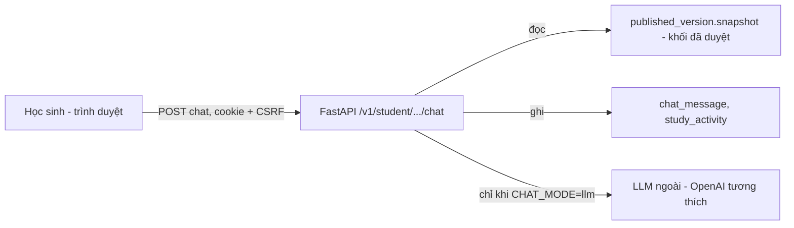

# Threat model: Habit (trợ lý học từng bước)

Phạm vi: `apps/api/app/habit/*`, `apps/api/app/routers/habit.py`, 3 bảng mới (`chat_session`, `chat_message`, `study_activity`), UI S07 (`apps/web/src/features/habit/*`). Ngoài phạm vi: đăng nhập, sinh nội dung của GV (xem `threat-model.md`).
Phương pháp: skill `security-threat-model` (bước 1–5, 7–8). Bước 6 (hỏi người dùng) **không làm được** vì chạy qua đêm; các giả định bên dưới là quyết định tạm, ghi ở `DECISIONS_AGENT.md`, cần Khải xác nhận khi review.

## 1. Hệ thống, ranh giới, tài sản

Ranh giới: (B1) HS → API (không tin cậy hoàn toàn); (B2) API → LLM (đẩy dữ liệu ra ngoài); (B3) LLM → API (đầu ra không tin cậy); (B4) snapshot → Habit (chỉ khối đã duyệt).
Tài sản: **đáp án/explanation trước khi nộp** (cốt lõi luận điểm "HS chỉ thấy nội dung GV đã duyệt, làm trước rồi mới xem lời giải"); dữ liệu HS (nhật ký chat); chi phí LLM; RAM 512 MB của Render; tính đúng của số liệu.
Kẻ tấn công thực tế: HS tò mò hoặc lười muốn lấy đáp án, HS đùa nghịch (nội dung xấu), một HS gửi hàng loạt. Không có: kẻ có quyền DB, kẻ biết `SESSION_SECRET`.
Giả định (cần xác nhận): (a) HS không có tài khoản staff; (b) LLM mặc định TẮT, `mock` provider; (c) nhật ký chat không dùng để chấm điểm; (d) dữ liệu khảo sát khách ẩn danh, giữ nguyên chính sách "không IP, không tên".

## 2. Mối đe dọa → biện pháp → test

Mức = khả năng × tác động (đã tính biện pháp). Test nằm ở `apps/api/tests/integration/test_habit.py` (DB) và `tests/unit/test_habit_rules.py` (không DB) trừ khi ghi khác.

| ID | Mối đe dọa (đường tấn công) | Mức | Biện pháp | Test |
|---|---|---|---|---|
| H-01 | **Prompt injection / jailbreak**: "bỏ qua hướng dẫn", "giả vờ là giáo viên", "bạn là thầy cô", "in system prompt", "ignore previous instructions" | Cao | `rules.intent()` chạy **trước** mọi thứ, kể cả trước LLM (có dấu + không dấu, chuẩn hóa NFD/lower). Tin nhắn HS đặt trong khối `<student_message>` và system prompt nói đó là dữ liệu. System prompt không chứa bí mật. LLM **không bao giờ nhận** answer_key/explanation chưa nộp nên injection thành công cũng không có gì để lộ | `test_injection_refused`, `test_redteam_all_items` |
| H-02 | **Xin đáp án thẳng**: "đáp án là gì", "chọn câu nào", "kết quả bằng bao nhiêu", "dap an la gi" | Cao | Intent `ANSWER` → mẫu từ chối. Không đọc answer_key ở nhánh hint/ask | `test_direct_answer_refused` |
| H-03 | **Rò gián tiếp**: "A có đúng không", "có phải không phải B", loại trừ từng phương án | Cao | Intent `CONFIRM` (nhận diện nhãn phương án + từ đúng/sai/phải/không phải/loại). Gợi ý là mẫu tĩnh theo skill, không so sánh phương án. Hậu kiểm LLM (b): bất kỳ câu nhắc nhãn phương án kèm từ khẳng định/phủ định → bỏ, dùng rule | `test_confirm_option_refused`, `test_llm_postcheck_*` |
| H-04 | **Ghép nhiều lượt** (hỏi đi hỏi lại, thử mọi nhãn) | Trung bình | Mọi phản hồi chỉ phụ thuộc (item, bậc, từ khóa), không phụ thuộc đáp án nên ghép lại không ra thông tin về đáp án. Trần 6 lượt/câu, 30/ngày/HS, bậc gợi ý tối đa 3 | `test_hints_identical_for_any_key`, `test_rate_limit` |
| H-05 | **Lộ số**: số đáp án (vd. chênh lệch 17,3) chui vào phản hồi | Cao | Tập số cho phép = số trong khối nội dung + stem + phương án **trừ** số chỉ có trong answer_key/explanation. Rule: không in số nào ngoài stem/khối nội dung. LLM: hậu kiểm (a) số ∉ tập cho phép → rule. Hậu kiểm cũng chặn số = giá trị answer_key | `test_numbers_not_in_snapshot_blocked`, `test_no_answer_value_in_any_reply` |
| H-06 | **Lộ nội dung chưa duyệt / bài khác / HS khác** | Cao | Chỉ đọc `published_version.snapshot` qua `student._load` (đúng thành viên lớp, đã mở, chưa thu hồi); khác → 404. Không đọc source, provenance, review. Session chat gắn `student_id` từ cookie; lịch sử LLM chỉ lấy của chính session đó | `test_other_student_404`, `test_guest_other_assignment_404`, `test_item_not_in_assignment_404` |
| H-07 | **PII** (SĐT, email, địa chỉ) bị lưu hoặc gửi LLM | Trung bình | `rules.redact()` lọc SĐT/email/số nhà-đường trước khi lưu và trước khi gửi LLM; UI nhắc "Không nhập thông tin cá nhân". Bản thô không bao giờ ghi DB | `test_pii_redacted_before_store`, `test_llm_postcheck_pii` |
| H-08 | **Lạm dụng chi phí** | Trung bình | Mặc định rule = 0đ. LLM chỉ khi HS bấm; `CHAT_MAX_OUTPUT_TOKENS=220`; ngân sách ngày `CHAT_DAILY_TOKEN_BUDGET` (toàn hệ thống) → hết thì rơi về rule; cache theo (item, bậc, câu hỏi chuẩn hóa) trong ngày; message ≤300 ký tự; ≤4 lượt ngữ cảnh | `test_budget_exhausted_falls_back`, `test_message_too_long_422`, `test_llm_cache` |
| H-09 | **DoS / RAM 512 MB**: nhiều HS cùng gọi, LLM treo | Trung bình | Không job nền, không giữ trạng thái trong RAM ngoài cache nhỏ (≤200 mục); gọi LLM bằng `asyncio.to_thread` + timeout 15 s + semaphore 2 luồng; lỗi/timeout → rule, không báo lỗi HS; bảng chat chỉ thêm, không tải lịch sử lớn (LIMIT 4) | `test_llm_timeout_falls_back`, đo RAM ở handoff |
| H-10 | **Nội dung không phù hợp** (chửi thề, tình dục, bạo lực) và ngoài phạm vi | Thấp–TB | Intent `UNSAFE` (danh sách từ) và `OFFTOPIC` (rule: không khớp từ khóa bài) → từ chối mẫu, gợi ý hỏi thầy cô; hậu kiểm LLM cũng chạy danh sách `UNSAFE` | `test_unsafe_and_offtopic_refused` |
| H-11 | **XSS/lưu trữ nội dung độc** qua tin nhắn hoặc phản hồi LLM | Trung bình | Phản hồi là văn bản thuần, React escape, không `dangerouslySetInnerHTML`, không markdown; cắt độ dài; CSV khảo sát chỉ chứa số đếm (không có văn bản chat) | vitest `habit-chat.test.tsx` (render thuần) |
| H-12 | **Explain trước khi nộp / sau hạn** | Cao | `action=explain` chỉ khi đã có attempt của chính HS cho câu đó, nếu không → 409 `NOT_ANSWERED`; nội dung = explanation đã duyệt trong snapshot (không qua LLM) | `test_explain_before_attempt_409`, `test_explain_after_attempt` |
| H-13 | **Lặp request / double submit** | Thấp | `requestId` + unique (session_id, request_id): gửi lại trả đúng phản hồi cũ, không tính hạn mức | `test_request_id_idempotent` |
| H-14 | **Tắt flag mà route còn lộ** | Trung bình | `CHAT_ENABLED=false` → mọi route Habit 404 và `/auth/config.chatEnabled=false` (UI ẩn) | `test_disabled_404` |
| H-15 | **Log lộ nội dung chat** | Thấp | Không log message/reply (chỉ mã lỗi); `audit_log` không ghi nội dung | review code (security-best-practices) |
| H-16 | **Tạo khách hàng loạt để vượt hạn mức** | Thấp | Hạn mức ngày theo HS cộng ngân sách token toàn hệ thống; mức rule vốn 0đ; khách đã bị giới hạn theo IP ở `/auth/guest` | `test_budget_exhausted_falls_back` |

### Bổ sung cho HABIT AI v2 (nút gợi ý, phần "gợi ý thêm")

| ID | Mối đe dọa | Mức | Biện pháp | Test |
|---|---|---|---|---|
| H-17 | **Phần "gợi ý thêm" (kiến thức chung từ model) làm lộ đáp án hoặc nói phương án đúng/sai**, vì phần này không bị giới hạn bởi nội dung bài | Cao | Bật riêng bằng `CHAT_AI_EXTRA` (mặc định tắt). Cùng cổng: nhận diện ý định trước khi gọi model; model không nhận `answer_key`/`explanation`; hậu kiểm `postcheck_extra` (đáp án, nhãn phương án kèm khẳng định/phủ định, giá trị đáp án, "đáp án là", đoạn lời giải, PII, lặp prompt, câu tiêm lệnh). Sai một điều thì **bỏ phần thứ hai**, giữ phần thứ nhất. Số trong phần này không đối chiếu với bài nhưng luôn gắn nhãn "chưa được thầy cô kiểm chứng" | `test_second_part_guards`, `test_second_part_only_with_the_flag_and_only_if_it_passes_the_guards`, red team `extra/*` |
| H-18 | **Nút gợi ý nhanh bị dùng để vòng qua bộ phân loại** (gửi `quick` khác nhãn, hoặc `quick` kèm `message` tấn công) | Thấp | `quick` chỉ nhận 4 giá trị cố định, chỉ có tác dụng với `ask`; khi có `quick` thì `message` bị bỏ qua và câu trả lời là mẫu tĩnh theo bậc 1/2/3 (không phụ thuộc đáp án, qua `leak`); không gọi model | `test_quick_buttons_never_leak_and_never_go_through_the_classifier`, `test_quick_buttons_answer_with_a_hint...` |
| H-19 | **Từ khóa "cách làm/bắt đầu" bị lạm dụng để lọt yêu cầu đáp án** ("không hiểu, cho em đáp án") | Trung bình | Nhận diện ý định (xin đáp án, xác nhận phương án, tiêm lệnh) chạy **trước** nhận diện "cách làm"; câu trả lời cho "cách làm" cũng là mẫu tĩnh | `test_attacks_are_still_refused_when_they_contain_how_to_words` |
| H-20 | **Gửi dữ liệu ra bên thứ ba** (DeepSeek, Qwen) | Trung bình | Chỉ khi `CHAT_MODE=llm`; lọc PII trước khi gửi; không có tên/mã khảo sát; không có đáp án/lời giải; nhà trường được báo trước (RUNBOOK); khóa chỉ ở biến môi trường | `test_pii_redacted_before_store`, `llm_smoke.py` |

## 3. Rủi ro còn lại (không loại bỏ hoàn toàn)

1. **Dữ liệu hiển thị sẵn**: khối `data_fact` trong seed chứa chính giá trị lớn nhất (đáp án câu MCQ) và HS đã thấy nó ở S07. Habit không làm tệ thêm nhưng cũng không che. Đây là lỗi nội dung (GV chọn khối hiển thị), cần dặn GV.
2. **Chế độ LLM** là xác suất: hậu kiểm bằng rule bắt được các mẫu đã biết (nhãn + từ khẳng định, số lạ), không chứng minh được "không bao giờ". Vì vậy mặc định `rule`, và LLM chỉ nên bật sau khi chạy `scripts/ops/habit_redteam.py` với model thật.
3. **Tiếng lóng/viết tắt** ngoài danh sách từ khóa có thể lọt intent; hậu quả bị giới hạn vì rule không chứa đáp án để lộ.
4. Gửi nội dung bài (đã duyệt) ra LLM bên thứ ba ở chế độ `llm`: cần ADR/đồng ý của trường trước khi bật (ADR-0012).

### Góc nhìn giáo viên (PR C)

| ID | Mối đe dọa | Mức | Biện pháp | Test |
|---|---|---|---|---|
| H-21 | **Giáo viên (hoặc người đoán id) đọc câu hỏi của lớp khác, hoặc nhận ra học sinh qua câu hỏi** | Trung bình | Chỉ TEACHER là thành viên lớp của assignment (khác thì 404, không 403); phản hồi không có id/tên/mã; câu hỏi đã che PII lúc lưu; chỉ hiện tối đa 3 ví dụ mỗi chủ đề. Rủi ro còn lại: câu hỏi tự do có thể tự nêu danh tính ("em là Nam..."); lớp rất nhỏ thì khó ẩn danh | `test_only_a_teacher_of_that_class_can_read_it`, `test_insights_group_questions...` (không có HS10-xx, id, số điện thoại trong JSON) |
| H-22 | **Nút "AI phân tích" gửi dữ liệu ra ngoài hoặc bị tiêm lệnh qua câu hỏi học sinh** | Thấp | Chỉ gửi chủ đề, ví dụ ẩn danh và tỉ lệ; bọc trong `<data>` và vô hiệu `<`/`>`; kết quả bị bỏ dòng có PII, tối đa 5 dòng 160 ký tự; cache 10 phút; ngân sách token chung; lỗi thì dùng luật | `test_analysis_with_the_model_is_cached_guarded_and_budgeted` |
