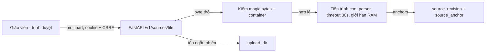

# Threat model: nạp giáo án nhiều định dạng (DOCX, PDF, XLSX, PPTX)

Phạm vi: `POST /v1/sources/file` (multipart), `apps/api/app/sources/*` (kiểm tra container, parser, chạy cách ly), S01 trên web. Ngoài phạm vi: sinh nội dung, duyệt, xuất bản (xem `threat-model.md`). Phương pháp: skill `security-threat-model` bước 1–5, 7–8; bước hỏi người dùng bỏ qua (chạy qua đêm), giả định ghi dưới đây và ở `DECISIONS_AGENT.md`.

## 1. Hệ thống và ranh giới

Ranh giới: (B1) trình duyệt → API (file hoàn toàn không tin cậy); (B2) API → tiến trình con parser (thư viện đọc file là bề mặt tấn công chính); (B3) parser → DB (văn bản đã rút ra sẽ được LLM đọc ở bước sinh: coi là dữ liệu, không phải chỉ dẫn, đã có ở `build_prompt`).
Tài sản: RAM/CPU 512 MB của Render; tính toàn vẹn của nguồn (mọi nội dung tới HS đều truy về nguồn); tách biệt dữ liệu giữa giáo viên; đĩa upload.
Kẻ tấn công: giáo viên (hoặc tài khoản bị chiếm) tải file độc, có chủ ý hoặc vô ý (file lấy từ mạng). Không có: kẻ truy cập đĩa, kẻ biết `SESSION_SECRET`. Giả định: chỉ TEACHER tải lên; không quét mã độc (đã chấp nhận ở D-001 #11, ghi lại bên dưới).

## 2. Mối đe dọa → biện pháp → test

Test ở `apps/api/tests/integration/test_upload.py` (cần DB) và `tests/unit/test_upload_parsers.py`. Fixture sinh trong test (`tests/upload_fixtures.py`), dữ liệu minh họa Địa lí, không dùng giáo án thật.

| ID | Mối đe dọa | Mức | Biện pháp | Fixture/test |
|---|---|---|---|---|
| U-01 | **Zip bomb** DOCX/XLSX/PPTX (nén cực cao, nhiều entry) | Cao | Đọc danh mục zip trước khi giải nén: ≤ 1000 entry, tổng giải nén ≤ 20 MB, tỉ lệ nén ≤ 100 cho phần > 1 MB; không bao giờ `extractall` | `bomb.docx/.xlsx/.pptx`, `many_entries.xlsx` → 422 `FILE_TOO_LARGE`/`INVALID_FILE` |
| U-02 | **PDF bomb** (nhiều trang, luồng nén lớn, đối tượng lồng) | Cao | ≤ 10 MB file, ≤ 50 trang (kiểm trước khi đọc chữ), parser chạy ở tiến trình con có timeout 30 s và giới hạn RAM, bị kill khi quá hạn | `many_pages.pdf` → 422 `SOURCE_TOO_LARGE`; `slow_parser` (giả lập treo) → 422 `PARSE_TIMEOUT` và tiến trình con bị kill |
| U-03 | **PDF có JavaScript / hành động tự chạy / đính kèm** | Trung bình | Từ chối nếu catalog có `/OpenAction`, `/AA`, `/JavaScript`, `/JS`, `/Launch`, `/EmbeddedFiles`, hoặc file mã hóa; chỉ lấy chữ, không bao giờ chạy gì | `js.pdf`, `embedded.pdf`, `encrypted.pdf` → 422 `ACTIVE_CONTENT_REJECTED` |
| U-04 | **Macro** (.docm/.xlsm/.pptm, `vbaProject.bin`, content-type `macroEnabled`) | Cao | Từ chối ở bước kiểm container, trước khi thư viện mở file | `macro.xlsx/.pptx/.docx` → 422 `MACRO_REJECTED` |
| U-05 | **Công thức Excel** (`=cmd|...`, `=HYPERLINK`, DDE) và CSV injection khi xuất | Trung bình | Mở `read_only=True, data_only=True`: chỉ đọc giá trị đã lưu, không tính, không thực thi; công thức không có giá trị lưu bị bỏ; ô chữ bắt đầu bằng `= + - @` vẫn là văn bản và xuất CSV có `_safe` | `formula.xlsx` → không có anchor chứa `=`; số lấy từ giá trị |
| U-06 | **Nội dung ngoài/nhúng** (liên kết ngoài, OLE, ActiveX, externalLink, ảnh/template từ xa) | Trung bình | Từ chối `Target` ngoài trừ hyperlink, `*/embeddings/`, `activeX`, `externalLinks` | `external.xlsx`, `embedded.pptx` → 422 `EXTERNAL_CONTENT_REJECTED` |
| U-07 | **File giả đuôi** (exe/png/zip đặt tên .pdf/.docx, .xls cũ) | Trung bình | Phân loại bằng magic bytes + `[Content_Types].xml`, bỏ qua tên và `Content-Type` do client gửi; loại không hỗ trợ → `INVALID_FILE`. Tên gốc không bao giờ thành đường dẫn: lưu bằng uuid | `fake.pdf` (PNG), `exe_as.docx`, `old.xls` (OLE) → 422 `INVALID_FILE`; `docx_named.pdf` được nhận đúng là DOCX |
| U-08 | **PDF scan không có lớp chữ** | Thấp | Không OCR (tốn RAM/CPU, nội dung không kiểm chứng). Không có chữ → ghi nguồn với `extractStatus=FAILED`, `extractError=SCANNED_PDF`, thông điệp tiếng Việt | `scan.pdf` → 201, FAILED, `SCANNED_PDF`; sinh nội dung từ nguồn FAILED bị từ chối |
| U-09 | **DoS RAM Render 512 MB** (nhiều upload cùng lúc, tệp lớn) | Trung bình | Giới hạn 10 MB, đọc cả tệp một lần rồi kiểm; parse trong tiến trình con có `RLIMIT_AS` (Linux) và tối đa 1 parse cùng lúc (semaphore); nội dung rút ra ≤ 5000 anchor, ≤ 5 sheet × 2000 ô, ≤ 60 slide | `test_parse_is_serialised`, giới hạn XLSX/PPTX |
| U-10 | **XXE / billion laughs** trong XML của OOXML | Trung bình | `defusedxml` được cài (openpyxl tự dùng), lxml của python-docx/pptx không phân giải entity; giới hạn giải nén chặn khuếch đại | `entity.xlsx` → bị từ chối hoặc không giải entity |
| U-11 | **Lộ dữ liệu giữa giáo viên** | Cao | Nguồn thuộc `owner_id`; xem/liệt kê anchors qua `_visible` (của mình hoặc SCHOOL); GV khác → 404 | `test_other_teacher_404` |
| U-12 | **Path traversal / tên file độc** | Thấp | Tên lưu là `uuid.ext` theo loại đã xác minh; `..` trong tên entry zip bị từ chối | `names_traversal.xlsx` → `INVALID_FILE` |
| U-13 | **Văn bản trong file chứa chỉ dẫn cho LLM** (prompt injection qua nguồn) | Trung bình | Không đổi: anchors vào `<anchors>` được coi là dữ liệu; mọi khối sinh ra vẫn phải qua GV duyệt và VAL-01..09; Mock là mặc định | (đã có test ở T9) |

## 3. Rủi ro còn lại
1. Không quét mã độc (không có ClamAV trên free tier). Hậu quả hạn chế vì file không bao giờ được chạy hay gửi cho HS, chỉ trích chữ/số. Cần quét nếu nhận file từ ngoài trường.
2. `RLIMIT_AS` chỉ có trên Linux (Render); trên Windows dev chỉ có timeout. Thư viện pypdf/openpyxl/python-pptx có thể có lỗi chưa biết: giữ phiên bản mới, chạy cách ly.
3. XLSX nhiều sheet: pipeline sinh cũ ghép ô theo (row, col) không theo sheet, nên bài sinh từ nhiều sheet có thể trộn ô; khuyến nghị 1 sheet dữ liệu.
