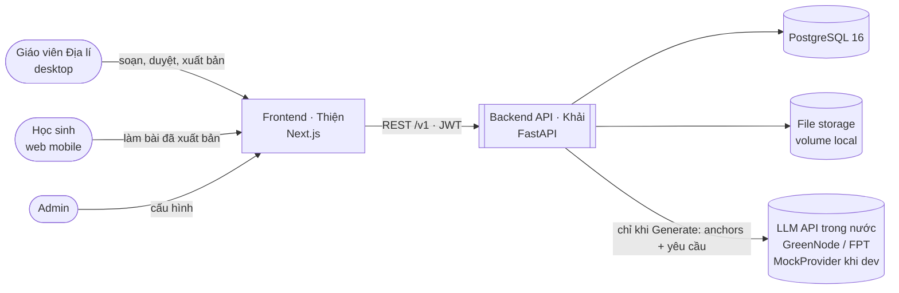
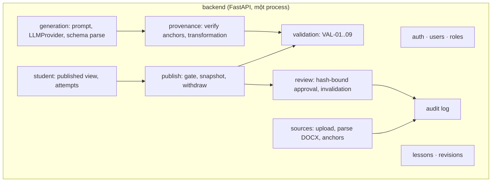
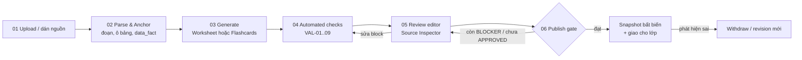
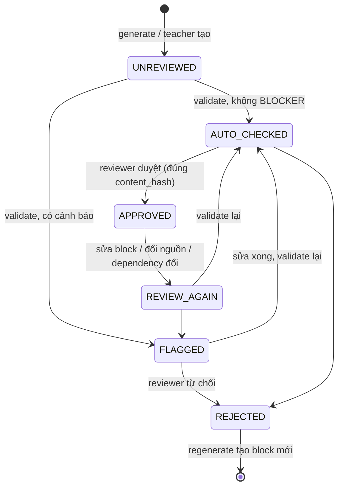
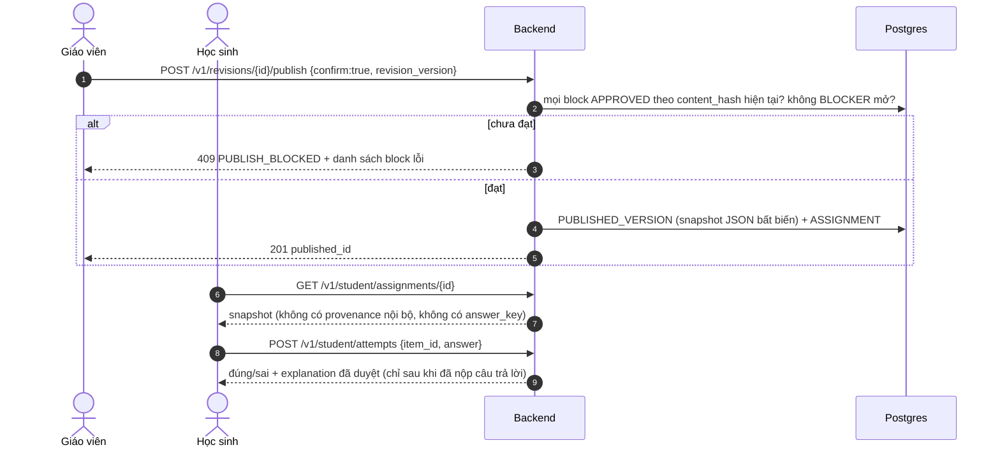

# PreClass AI v2 — Kiến trúc, sơ đồ và timeline backend

## 0. Phạm vi đã chốt cho P0

| Hạng mục | P0 (đến 18/11) | Để sau |
|---|---|---|
| Môn, bài | Địa lí, chương trình mới; 6 bài (3 lớp 10 + 3 lớp 11) | Môn khác |
| Nguồn đầu vào | Văn bản dán vào, DOCX (đoạn + bảng) | PDF, PPTX, OCR |
| Đầu ra | **Worksheet**, **Flashcards** | Slides (P0.5), Visual Story, Infographic, Mind map, audio |
| Giáo viên | Source Library, Generate, Content Editor + Source Inspector, Review Queue, Publish Gate, Version History | Reviewer hai bước |
| Học sinh | Mở bài đã xuất bản; **tự làm trước, xem giải thích đã duyệt sau** | Chat AI với học sinh |
| Đội dev | Khải: backend + AI · Thiện: frontend | |

Nguyên tắc giữ nguyên từ tài liệu team: PR-01…PR-06 (nguồn ≠ đúng; giáo viên duyệt thực chất; evidence first; nội dung sửa được; bản xuất bản bất biến; nguồn do server xác minh).

---

## 1. System context



Học sinh không bao giờ gọi tới LLM. AI chỉ chạy khi giáo viên bấm Generate.

## 2. Containers và module backend



Quy tắc: chỉ `generation` gọi LLM; chỉ `review` tạo/huỷ approval; chỉ `publish` tạo snapshot; mọi route kiểm tra quyền trước khi đọc/ghi.

## 3. Data model (ERD)

```mermaid
erDiagram
    USER ||--o{ CLASS_MEMBER : in
    CLASS ||--o{ CLASS_MEMBER : has
    USER ||--o{ SOURCE_ASSET : owns
    SOURCE_ASSET ||--o{ SOURCE_REVISION : versions
    SOURCE_REVISION ||--o{ SOURCE_ANCHOR : contains
    USER ||--o{ LESSON : authors
    LESSON ||--o{ LESSON_REVISION : versions
    LESSON_REVISION ||--o{ LESSON_SOURCE : uses
    SOURCE_REVISION ||--o{ LESSON_SOURCE : "used by"
    LESSON_REVISION ||--o{ CONTENT_BLOCK : contains
    CONTENT_BLOCK ||--o{ PROVENANCE_LINK : cites
    SOURCE_ANCHOR ||--o{ PROVENANCE_LINK : "cited by"
    CONTENT_BLOCK ||--o{ BLOCK_DEPENDENCY : "depends on"
    CONTENT_BLOCK ||--o{ TRANSFORMATION_EVENT : history
    CONTENT_BLOCK ||--o{ VALIDATION_RESULT : checked
    CONTENT_BLOCK ||--o{ REVIEW_EVENT : reviewed
    LESSON_REVISION ||--o| PUBLISHED_VERSION : "published as"
    PUBLISHED_VERSION ||--o{ ASSIGNMENT : "assigned to"
    CLASS ||--o{ ASSIGNMENT : receives
    ASSIGNMENT ||--o{ STUDENT_ATTEMPT : has
    USER ||--o{ STUDENT_ATTEMPT : makes
    LESSON_REVISION ||--o{ GENERATION_JOB : runs
    USER ||--o{ AUDIT_LOG : actor
```

## 4. Luồng giáo viên end-to-end



## 5. Sequence — Generate có kiểm chứng nguồn

```mermaid
sequenceDiagram
    autonumber
    actor GV as Giáo viên
    participant API as Backend
    participant DB as Postgres
    participant L as LLM
    GV->>API: POST /v1/lessons/{id}/generate {output_type, goal, n_items}
    API->>DB: lấy anchors của các source revision gắn với lesson
    API->>L: system prompt + anchors (id + text) + JSON schema
    L-->>API: blocks[] (payload, transformation, anchor_ids, rationale)
    API->>API: parse Pydantic; anchor_id không thuộc danh sách → bỏ link, block FLAGGED
    API->>API: ORIGINAL → so khớp nguyên văn; số trong payload ∉ anchor → FLAGGED
    API->>DB: CONTENT_BLOCK (UNREVIEWED/FLAGGED), PROVENANCE_LINK, TRANSFORMATION_EVENT, VALIDATION_RESULT
    API-->>GV: 202 job_id → GET /v1/jobs/{id} → done
```

## 6. Trạng thái review của một block



## 7. Sequence — Publish gate và học sinh làm bài



## 8. Timeline (2 dev)

| Ngày | Khải — Backend + AI | Thiện — Frontend | Bàn giao / mốc |
|---|---|---|---|
| **T6 13/11** | Claude Code chạy prompt: khung dự án, DB, migration, seed, auth, **OpenAPI v0**, MockProvider | Dựng khung FE, design system, màn S01 Source Library bằng mock | Khải kiểm tra kết quả agent khi hạ cánh |
| **T7 14/11** | Review code agent; sources + anchors (DOCX); lessons/revisions; **đóng băng hợp đồng API v1** | Sinh client từ `openapi.json`; S02 Generate, S03 Editor dùng Prism mock | **H1: gửi Thiện `openapi.json`, `API_GUIDE.md`, tài khoản seed** |
| **CN 15/11** | Generate (Mock + provider thật), provenance verify, validation VAL-01..09 | S03 Editor + Source Inspector, S04 Review Queue | |
| **T2 16/11** | Review hash-bound, invalidation dependency, publish gate, withdraw, student API | S05 Publish Gate, S06 History, S07 Student View | Backend chạy trên staging cho Thiện gọi thật |
| **T3 17/11** | AT-01..14 xanh; Docker Compose prod; seed 6 bài mock; sửa lỗi tích hợp | Nối API thật, xử lý lỗi 409/422, responsive mobile cho học sinh | **H2: staging ổn định** |
| **T4 18/11** | Trực sửa lỗi theo kết quả kiểm thử | **Kiểm thử FE end-to-end** trên staging | **Mốc kiểm thử** |
| T5–T6 19–20/11 | Deploy production; backup; RUNBOOK | Sửa UI | Deploy thành công |

Quy tắc phối hợp: thay đổi hợp đồng API sau H1 phải qua issue `api-change` và bump `info.version` trong OpenAPI; không đổi tên field đã đóng băng, chỉ thêm field.
